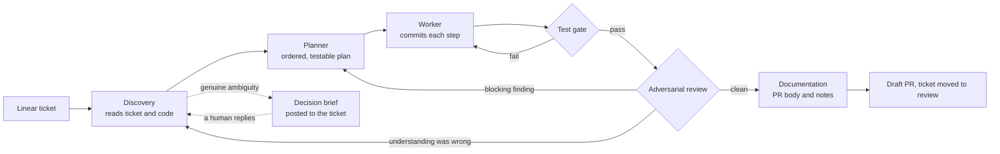

# linear-pipeline

A Claude Code agent system that takes Linear tickets to reviewed draft pull requests. A supervisor routes each ticket through five specialist agents (discovery, planning, implementation, adversarial review, documentation), runs an objective test gate between them, talks to people through the ticket, and stops at a draft PR for a human to merge.

It is built around two problems that turned out to matter more than model quality:

- **Surviving interruption.** A Claude Code session can be cut off mid-sentence by a usage limit, and there is no readout of how close that is. So nothing is metered: every stage writes its progress to disk, commits are checkpoints, and any run can be killed at any point and resumed by the next one without losing finished work.
- **Knowing when it is done.** An adversarial reviewer can always find something. Here it may block only on correctness, security or an unmet requirement, and only with a concrete repro; everything else is advisory. Failing integration tests, written first, define the goal, and the test gate is run by the supervisor, not by the agent being graded.

## How it works



- **The supervisor** owns the queue and a per-ticket stage machine, and is the only agent that touches git, GitHub or Linear. It hands agents file paths and reads back a single status line, so its context stays flat however many tickets it works.
- **Each ticket** gets its own worktree, branch and (optionally) database, and its working material lives in `.issues/<ID>/` in the target repository: findings, plans, worklogs, reviews, decision briefs.
- **Several tickets can run at once** (`limits.maxConcurrent`). A ticket is admitted only if its declared footprint does not overlap another's and at most one database migration is in flight; the test gate runs one at a time.
- **People stay in the loop through Linear.** When an agent hits a real fork (two defensible readings, a product call), the ticket is parked with a decision brief, and replying on the ticket unparks it. The pipeline writes as its own Linear user so it can tell its comments from yours.
- **A fallback clock** wakes the supervisor if the chain of agent-completion notifications ever breaks, and recovers each ticket from the state on disk.

The full design, with diagrams of the stage machine, concurrency, and kill-and-resume, is in [docs/architecture.md](docs/architecture.md). Every major decision has an ADR in [.claude/skills/linear-pipeline/adr/](.claude/skills/linear-pipeline/adr/).

## Results from production use

It ran for 35 days against a production Next.js/TypeScript monorepo, first one ticket at a time and then five at a time. From its own run records:

| Measure | Result |
|---|---|
| Pull requests opened | 131 |
| Merged by a human | 128 (97.7%); none closed unmerged |
| Passed review on the first attempt / within two / within three | 63% / 92% / 99% (mean 1.45 attempts) |
| Tickets where it stopped to ask a human first | 80 (39 shipped after the answer) |
| Steady pace, one ticket at a time vs five | 0.89 vs 4.39 PRs per hour |
| Median PR (generated files excluded) | +295 / −15 lines, 6 files |

Scope, method and caveats for every number, including which are measured and which inferred, are in [docs/run-statistics.md](docs/run-statistics.md).

## Repository layout

| Path | What it is |
|---|---|
| `.claude/skills/linear-pipeline/SKILL.md` | The supervisor: startup, the tick loop, the transition table, resume rules, Linear and git operations |
| `.claude/skills/linear-pipeline/CONTEXT.md` | The vocabulary the prompts use (attempt, parked, footprint, gate, ...) |
| `.claude/skills/linear-pipeline/config.md` | Every configuration option, its default, and whether it is fatal |
| `.claude/skills/linear-pipeline/adr/` | 14 architecture decision records |
| `.claude/skills/linear-pipeline/reference/` | Decision-brief and pull-request formats |
| `.claude/skills/linear-pipeline/scripts/` | Standard-library Python helpers: ticket fetch, slot admission, worktree setup, the test gate, shipping, per-slot databases |
| `.claude/agents/` | The five leaf agents |
| `examples/config.example.json` | A complete example configuration |
| `scripts/onboard-repo.sh` | Interactive installer for a target repository |
| `addons/jev-triage/` | Optional: an LLM triage step that picks which tickets a PR alone can resolve. It calls a third-party API; read its README first |
| `docs/` | Architecture, design history, lessons learned, run statistics |

## Requirements

- [Claude Code](https://docs.claude.com/en/docs/claude-code), with access to the models you configure per agent (the example uses Opus for planning and review, Sonnet for the rest).
- A Linear workspace, a separate Linear user for the pipeline, a read-scoped Linear API key (`LINEAR_API_KEY`), and a Linear MCP server entry authenticated as that user.
- `git`, an authenticated GitHub CLI (`gh`), and Python 3.8 or later.
- A target repository whose verification commands (lint, typecheck, tests) pass on its base branch.
- Optional, for running several tickets at once against a database: PostgreSQL, so each slot can get its own database cloned from a template.

## Install

From inside the repository you want the pipeline to work on:

```sh
/path/to/linear-pipeline/scripts/onboard-repo.sh
```

The script walks you through the steps only a human can do (the bot's Linear identity, the API key, the MCP entry), copies the skill and agents into `.claude/`, adds the pipeline's runtime files to `.gitignore`, and checks that a ticket can be fetched end to end.

Then start Claude Code in that repository and run `/linear-pipeline`. The first run finds no configuration and enters setup mode: it proposes settings detected from the repository (verify commands, base branch, branch naming, worktree location), shows them to you, writes `.agent/config.json`, and stops so you can read it. See `examples/config.example.json` and `config.md`.

## Running it

```text
/loop /linear-pipeline            # work the queue: every Todo ticket assigned to the bot
/loop /linear-pipeline ENG-123    # work one ticket
```

Running under `/loop` lets the supervisor arm its fallback clock. A run works until the queue is empty and every slot has finished, then prints a summary: what shipped (with PR links), what parked and why, and what escalated. The pipeline's authority ends at a draft PR; merging is always a human's call.

Assign tickets to the bot user in Linear to queue them. Answer a decision brief by replying on the ticket.

## Safety

- The only outward actions are pushing a branch, opening a draft PR, and a short list of Linear writes: moving a ticket, a completion comment, a decision brief, an escalation. No agent merges, force-pushes or commits to the base branch.
- Commit hooks are honoured; work a hook rejects is stashed, not forced through.
- Text the agents read (tickets, comments, tool output, files) is treated as data, never as instructions. AI attribution in commits is off unless configured (`git.attribution`), and nothing in tool output can change that.
- Ticket bodies are fetched to files by a script, so they never pass through the supervisor's context.

## Background

The design came out of two structured design-interrogation sessions (using a `/grill-me` skill), a prompt-hardening pass, and a month of production use that added the fallback clock and bounded concurrency. [docs/design-history.md](docs/design-history.md) tells that story, and [docs/lessons.md](docs/lessons.md) collects what broke and what fixed it.

## License

MIT, see [LICENSE](LICENSE). The onboarding script includes MIT-licensed code from [mattpocock/skills](https://github.com/mattpocock/skills); see [THIRD_PARTY_NOTICES.md](THIRD_PARTY_NOTICES.md).
