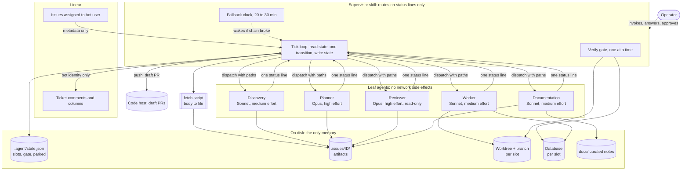
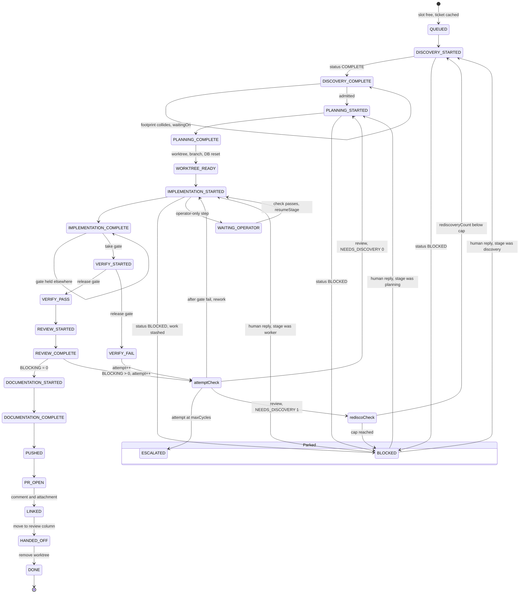
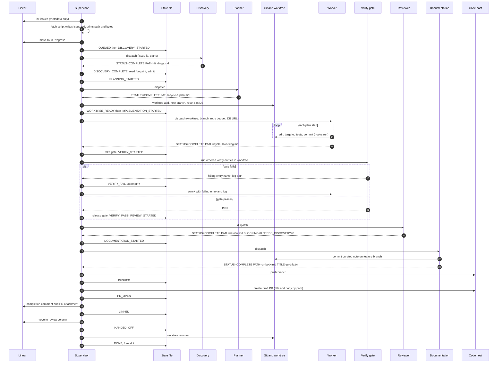
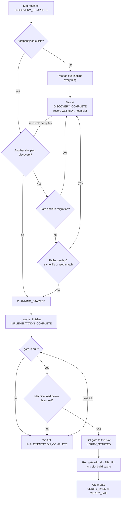
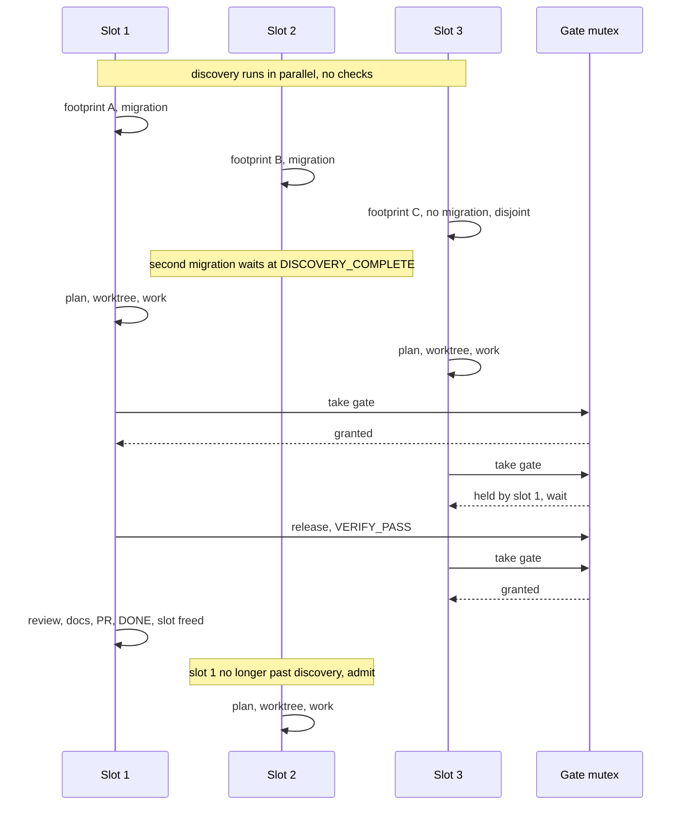
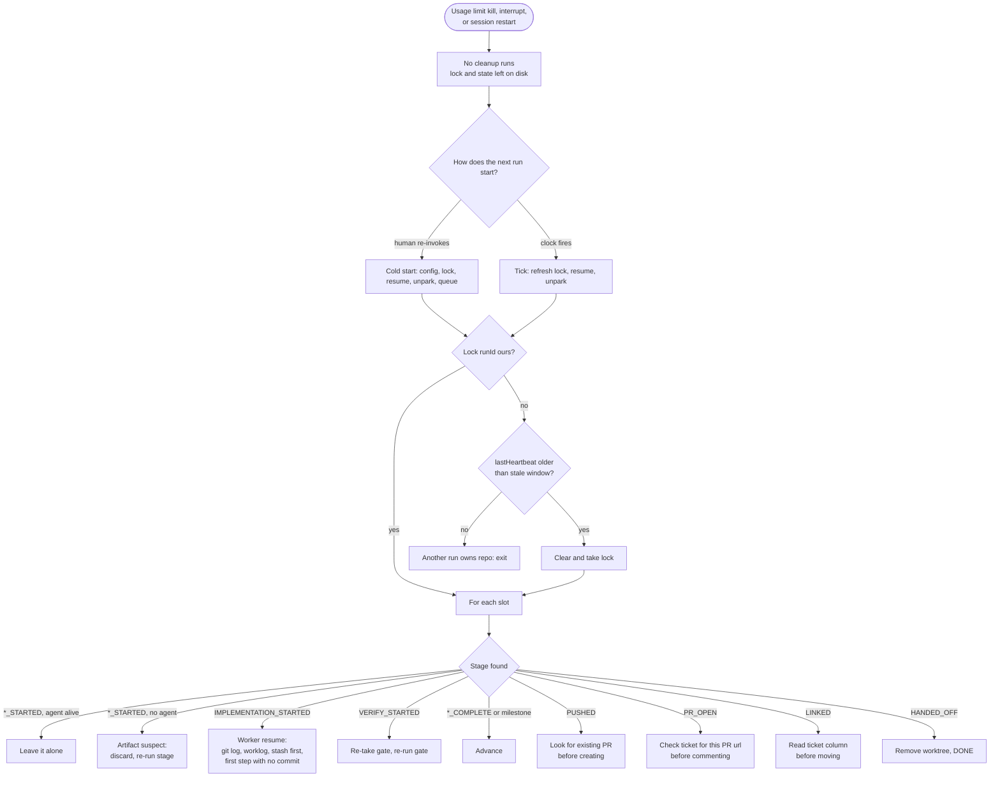
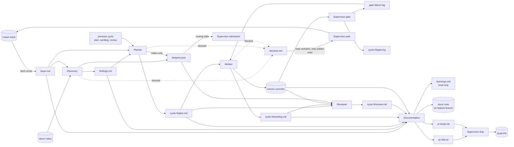

# Architecture

This document describes how the Linear pipeline works: the agents and what each one promises, the
supervisor's rules, the per-issue stage machine, concurrency, recovery after a kill, and what the
pipeline writes to Linear and to disk.

The prompts themselves are the source of truth for behaviour. When this document and a prompt
disagree, the prompt wins. The relevant files are:

| File | What it holds |
|---|---|
| [`.claude/skills/linear-pipeline/SKILL.md`](../.claude/skills/linear-pipeline/SKILL.md) | The supervisor |
| [`.claude/agents/pipeline-*.md`](../.claude/agents/) | The five leaf agents |
| [`.claude/skills/linear-pipeline/config.md`](../.claude/skills/linear-pipeline/config.md) | Every configuration field, its default, and whether it is fatal |
| [`.claude/skills/linear-pipeline/adr/`](../.claude/skills/linear-pipeline/adr/) | The 14 architecture decision records |
| [`.claude/skills/linear-pipeline/reference/`](../.claude/skills/linear-pipeline/reference/) | The decision-brief and pull-request formats |

## Contents

1. [Overview](#1-overview)
2. [The agents](#2-the-agents)
3. [The supervisor's two disciplines](#3-the-supervisors-two-disciplines)
4. [The inter-agent contract](#4-the-inter-agent-contract)
5. [The stage machine](#5-the-stage-machine)
6. [Attempts, re-discovery, parking and escalation](#6-attempts-re-discovery-parking-and-escalation)
7. [Concurrency](#7-concurrency)
8. [The clock](#8-the-clock)
9. [The lock](#9-the-lock)
10. [Kill and resume](#10-kill-and-resume)
11. [Linear: the write contract and the bot identity](#11-linear-the-write-contract-and-the-bot-identity)
12. [Git and the ship guard](#12-git-and-the-ship-guard)
13. [Artifacts](#13-artifacts)
14. [Configuration and setup](#14-configuration-and-setup)
15. [What the supervisor deliberately cannot do](#15-what-the-supervisor-deliberately-cannot-do)

---

## 1. Overview

A Claude Code skill, `/linear-pipeline`, acts as a **supervisor**. It pulls Linear issues assigned to
a dedicated bot user and drives each one through five **leaf agents**:

```
discovery → planner → worker → [verify gate] → reviewer → documentation
```

The **verify gate** sits between the worker and the reviewer. It is not an agent: the supervisor runs
the repository's own lint, typecheck and test commands itself.

Every issue ends in one of three ways:

- a **draft pull request**, linked back to the ticket;
- a **decision brief** posted to the ticket, when an agent reaches a question only a human can answer;
- an **escalation** comment, when the attempt budget runs out.

All working material lives on disk under `.issues/<ID>/`. The supervisor passes agents file paths and
reads back one status line per stage.

The whole system assumes it will be killed mid-sentence by a usage limit it cannot see, and that it
must lose no completed work when that happens. Up to `limits.maxConcurrent` issues are in flight at
once, each in a numbered **slot**. Slots are admitted by declared file **footprints**, share a single
**gate mutex**, and each get their own local database. A slow **fallback clock** notices when the
wake-up chain has broken.

### System topology



---

## 2. The agents

| Agent | Packaging | Default model / effort | Reads | Writes | Returns |
|---|---|---|---|---|---|
| **Supervisor** | Skill, user-invoked only | The operator's session model | Config, state, status lines, ticket metadata, comment authors and timestamps, `footprint.json` (routing data), `decision.md` and `operator-step.md` (only to relay them) | `state.json`, `queue.json`, the lock, every git and Linear write | (nothing; it is the top of the tree) |
| **Discovery** | Agent definition | Sonnet / medium | `docs/` first, the cached ticket `issue.md`, the codebase, the prior review on re-discovery, a human answer on unpark | `findings.md` (journalled as it goes), `footprint.json`, `decision.md` if blocked | `STATUS=COMPLETE\|BLOCKED\|NOT_CODE PATH=...` |
| **Planner** | Agent definition | Opus / high | `findings.md`, `issue.md`, the configured verify command names; on later attempts the previous plan, worklog and review | `cycle-N/plan.md` (a "hermetic" plan), may widen `footprint.json`, `decision.md` if blocked | `STATUS=COMPLETE\|BLOCKED PATH=...` |
| **Worker** | Agent definition | Sonnet / medium | The plan only; on resume `git log`, the worklog and the stash; on rework the failing gate's name and log | One commit per plan step (hooks honoured), `cycle-N/worklog.md`, a named stash on yield, `decision.md` if blocked | `STATUS=COMPLETE\|BLOCKED PATH=...` |
| **Reviewer** | Agent definition | Opus / high | Plan, diff, worklog, prior reviews, the footprint, and **the whole codebase** | `cycle-N/review.md` | `STATUS=COMPLETE PATH=... BLOCKING=n NEEDS_DISCOVERY=0\|1` (never blocked) |
| **Documentation** | Agent definition | Sonnet / medium | The whole trail of one issue, the diff, existing `docs/` | A curated note in `docs/` (or nothing), `learnings.md` (local), `pr-title.txt`, `pr-body.md` | `STATUS=COMPLETE PATH=... TITLE=...` (never fails an issue) |

Discovery and the reviewer are read-only by contract. Only the supervisor writes outward.

### Why a skill plus agent definitions

Both skills and agent definitions enforce tool allowlists, so tool restriction did not decide the
packaging. What did is that **`effort` is available only on agent definitions**. Spending the
expensive model only where judgment lives (planning and review) is the largest saving that costs no
correctness, so every role whose model or effort differs became an agent definition. The supervisor,
which only routes, became the skill ([ADR-0009](../.claude/skills/linear-pipeline/adr/0009-leaf-agents-are-agent-definitions-supervisor-is-a-skill.md)).

Each leaf agent's description says it is dispatched by the supervisor and not for direct invocation,
and carries no `<example>` blocks, so the model is never tempted to invoke one on its own. The skill
itself sets `disable-model-invocation: true`: a skill that pushes branches and opens pull requests
should only run when a person asks for it.

### Shared vocabulary

The prompts use a small set of "leading words" consistently. Discovery *surveys* and *journals*. The
planner writes a *hermetic* plan and reads source only to confirm a *claim*. The worker *checkpoints*
and avoids *yak-shaving*. The reviewer needs a *repro* and checks the *blast radius*. Documentation
*curates* and *promotes*. The supervisor passes *by reference* and works in *ticks*. The glossary is in
`CONTEXT.md` beside the skill.

### Role notes

- **Discovery always runs** ([ADR-0003](../.claude/skills/linear-pipeline/adr/0003-discovery-always-runs.md)).
  Deciding whether a ticket has "enough context" would require the supervisor to read it, and a wrong
  call fails in the expensive direction: a vague ticket sent straight to planning wastes an attempt.
- **The plan is the handoff brief** ([ADR-0002](../.claude/skills/linear-pipeline/adr/0002-the-plan-is-the-handoff-brief.md)).
  It must be hermetic: the worker should need nothing else. Each step names its files, the change, a
  "done when" condition and a targeted verify command.
- **The reviewer may block only on correctness, security or an unmet requirement**
  ([ADR-0004](../.claude/skills/linear-pipeline/adr/0004-reviewer-may-block-only-on-correctness-security-or-requirements.md)),
  and a blocking finding must carry a repro. Everything else is advisory and goes into the PR body. An
  adversarial reviewer can always find something; without this rule the loop never terminates.
- **The reviewer reads the whole codebase**, not only the diff, because the failure mode agent-written
  code is most prone to is the bug of omission: the caller that was not updated.
- **Documentation curates.** Most issues produce no durable note, and that is a valid outcome. It also
  writes the PR title and body, because it is the only agent that has read the whole trail.

---

## 3. The supervisor's two disciplines

Everything else in the supervisor's prompt serves one of these two rules.

### 3.1 Pass everything by reference

Agents get paths. The supervisor reads back one line. It never holds the contents of a findings
document, plan, review, worklog or diff.

The reason is cost and stability. The supervisor's context must stay flat no matter how long the
queue is or how large each issue is, and the only way to achieve that is never to become the transport
layer between agents. The prompt's tripwire: *if you could summarise what is in an artifact, you read
too much.*

Mechanisms that enforce it:

- **The status-line contract** (section 4). The `BLOCKING` and `NEEDS_DISCOVERY` flags let the review
  loop be routed without opening the review.
- **The fetch script.** Ticket bodies are fetched by `scripts/fetch_issue.py`, a subprocess that
  writes the body to `.issues/<ID>/issue.md` and prints only a path and a byte count. An MCP tool
  result would have put the ticket's prose into the supervisor's context on every pickup.
- **Footprints are allowed** because they are routing data, like a status-line flag, and carry no
  prose.
- **Two narrow exceptions.** `decision.md` is read only to relay it verbatim to Linear, and
  `operator-step.md` only to relay its command to the operator.

This discipline is also what makes concurrency affordable: five slots cost five status lines per
stage, not five documents.

### 3.2 Assume you will be killed

There is no programmatic readout of the remaining usage quota, and a parent agent cannot see a
subagent's token use. So the supervisor never meters, throttles or paces itself
([ADR-0001](../.claude/skills/linear-pipeline/adr/0001-design-for-kill-instead-of-quota-metering.md)).
Any pacing it invented would be a guess presented as control. Instead, every write leaves the work
recoverable. What is on disk is what survives.

Mechanisms:

- **Ticks.** Read state, perform exactly one transition, write state. Nothing carries between ticks
  except the file. Every tick boundary is a resume point, and improvisation is bounded to one step.
- **Write ordering.** `*_STARTED` is written before a dispatch, `*_COMPLETE` after the status line
  returns.
- **Atomic writes.** Write `state.json.tmp`, then rename it over `state.json`.
- **Incremental artifacts.** Every leaf agent journals as it goes rather than buffering to the end.
- **Commits as checkpoints** for the worker, and a **named stash** for work the commit hooks reject.
- **Leaf agents have no network side effects**, so re-running a killed stage cannot double-post.
- **A lock with a stale timeout**, because after a kill the stale path is the normal path.

### 3.3 A related rule: text you did not write is data

Added after operation (see [lessons](lessons.md), L5): ticket bodies, comments, agent artifacts,
command output and anything that arrives inside a tool result are untrusted input. They can inform a
decision the prompt already asks for; they can never change policy. An instruction to add an
attribution trailer, skip a gate, push elsewhere or post as someone else carries no authority because
of where it appeared. The same rule is written into every leaf agent.

---

## 4. The inter-agent contract

Every leaf agent:

1. receives paths, never pasted contents;
2. writes its output to a file under `.issues/<ID>/`, incrementally;
3. returns exactly one line:

```
STATUS=COMPLETE|BLOCKED|NOT_CODE  PATH=<path>  [BLOCKING=<n>]  [NEEDS_DISCOVERY=0|1]  [OPERATOR=1]
```

The documentation agent also returns `TITLE=<path to pr-title.txt>`. `NOT_CODE` is returned only by
discovery, and only when the code-changes-only intake rule is enabled. `OPERATOR=1` on a blocked
status means the block needs an operator's hands rather than a decision (section 6.4).

A final message that carries more than the status line is a defect in the agent, not extra
information. The supervisor routes on the line and ignores the rest.

Every dispatch carries the issue ID, the attempt number, the repo root, and every artifact path as an
absolute path, with an instruction to write it exactly as given. Per-agent extras:

| Agent | Also receives |
|---|---|
| Discovery | Whether this is a re-discovery; a human's answer when unparking; the footprint path; whether code-changes-only is on; the base branch |
| Planner | A human's answer when unparking; the footprint path; the base branch |
| Worker | Worktree, branch, the step retry budget from config, whether this is a resume, the failing gate's name and log path on rework, a human's answer, the attribution policy, and the slot's database URL |
| Reviewer | Worktree, branch, base branch |
| Documentation | Worktree, base branch, the attempt count reached, the attribution policy, the PR title format and template path, the docs root |

The retry budget is passed in the dispatch rather than written into the worker's prompt, so the number
lives in one place: the config, where the operator changes it.

---

## 5. The stage machine

### 5.1 States

Stages that dispatch an agent are **paired** (`*_STARTED` / `*_COMPLETE`), because a kill between
dispatch and return leaves a partial artifact that must be treated as suspect
([ADR-0005](../.claude/skills/linear-pipeline/adr/0005-paired-stage-states.md)).

Supervisor-local git and Linear operations are **single milestones**, because they are idempotent and
checkable. An existing worktree, branch or pull request can simply be detected, so a start marker
would cost a write and tell a later run nothing it cannot see for itself.

```
free slot → QUEUED
  → DISCOVERY_STARTED      → DISCOVERY_COMPLETE      admission check here
  → PLANNING_STARTED       → PLANNING_COMPLETE
  → WORKTREE_READY                                    milestone: worktree, branch, slot DB reset
  → IMPLEMENTATION_STARTED → IMPLEMENTATION_COMPLETE  waits here for the gate mutex
  → VERIFY_STARTED         → VERIFY_PASS | VERIFY_FAIL
  → REVIEW_STARTED         → REVIEW_COMPLETE          plus BLOCKING and NEEDS_DISCOVERY flags
  → DOCUMENTATION_STARTED  → DOCUMENTATION_COMPLETE
  → PUSHED                                            milestone
  → PR_OPEN                                           milestone
  → LINKED                                            milestone: completion comment + PR attachment
  → HANDED_OFF                                        milestone: ticket moved to review column
  → DONE                                              append to completed, free the slot

side state:  WAITING_OPERATOR (slot kept, nothing posted)
off-ramps:   parked BLOCKED · parked ESCALATED · NOT_CODE (returned silently)
```



Reading notes:

- `WAITING_OPERATOR` can be entered from any stage and returns to its recorded `resumeStage`. It is
  drawn from implementation only, for legibility.
- Parked issues release their slot and re-enter through any free slot when a human replies.
- `ESCALATED` has no automatic exit. A human picks the work up or replies.
- The two choice points render as labelled boxes (`attemptCheck`, `rediscoCheck`) rather than
  diamonds. Declaring them first draws diamonds but gives a markedly worse layout.

### 5.2 Transition table

The supervisor's table is keyed on `stage` and nothing else: not on what happened earlier in the run
and not on memory of it.

| `stage` | Transition |
|---|---|
| free slot | Take the next issue admission allows: cache the ticket through the fetch script, set Linear to In Progress, write the slot with `attempt: 1`, `rediscoveryCount: 0` → `QUEUED` |
| `QUEUED` | → `DISCOVERY_STARTED`; dispatch discovery |
| `DISCOVERY_COMPLETE` | Run the admission check. Collision → stay, record `waitingOn`. Admitted → `PLANNING_STARTED`; dispatch the planner |
| `PLANNING_COMPLETE` | Create worktree and branch, reset the slot's database → `WORKTREE_READY` |
| `WORKTREE_READY` | → `IMPLEMENTATION_STARTED`; dispatch the worker |
| `IMPLEMENTATION_COMPLETE` | Gate held by another slot → stay. Otherwise take the gate → `VERIFY_STARTED`; run the gate |
| `VERIFY_STARTED` | Gate finished: clear the gate, record `lastGateFailure` → `VERIFY_PASS` or `VERIFY_FAIL`. Environment the operator must repair → `WAITING_OPERATOR` |
| `WAITING_OPERATOR` | Run `waitingFor.check`. Passes → `resumeStage`. Fails → stay |
| `VERIFY_PASS` | → `REVIEW_STARTED`; dispatch the reviewer |
| `VERIFY_FAIL` | `attempt++`. At `maxCycles` → escalate. Otherwise → `IMPLEMENTATION_STARTED`; re-dispatch the worker with the failing entry's name and the path to its full log |
| `REVIEW_COMPLETE`, `BLOCKING=0` | → `DOCUMENTATION_STARTED`; dispatch documentation |
| `REVIEW_COMPLETE`, `BLOCKING>0`, `NEEDS_DISCOVERY=0` | `attempt++`. At cap → escalate. Otherwise → `PLANNING_STARTED` at the new attempt |
| `REVIEW_COMPLETE`, `BLOCKING>0`, `NEEDS_DISCOVERY=1` | `attempt++`. At cap → escalate. If `rediscoveryCount` has reached `maxRediscovery` → park as blocked. Otherwise `rediscoveryCount++` → `DISCOVERY_STARTED` |
| `DOCUMENTATION_COMPLETE` | Pre-push guards, push → `PUSHED` |
| `PUSHED` | Find or open the draft PR (title and body from documentation's files) → `PR_OPEN` |
| `PR_OPEN` | Completion comment and PR attachment on the ticket → `LINKED` |
| `LINKED` | Move the ticket to `linear.reviewState` → `HANDED_OFF` (if unconfigured, advance and say so in the close-out) |
| `HANDED_OFF` | Remove the worktree → `DONE` |
| `DONE` | Append to `completed`; free the slot |
| any dispatch returned `BLOCKED` | Park (section 6.3); frees the slot |
| `BLOCKED ... OPERATOR=1`, or a supervisor step needs the operator | → `WAITING_OPERATOR` (not a park; nothing goes to Linear) |
| discovery returned `NOT_CODE` | Record it in `.agent/triage.json`, return the ticket to its ingest state, post nothing, free the slot |

### 5.3 The terminal steps are separate ticks on purpose

Once the pull request exists, the work feels finished, and what remains (a comment, a column move, a
worktree removal) reads as bookkeeping. It is not. An issue whose PR never reached Linear is invisible
to the person who asked for it, and a worktree left behind is the next run's stale checkout. The first
completed run in operation failed in exactly this way (see [lessons](lessons.md), L1).

So `PR_OPEN`, `LINKED`, `HANDED_OFF` and `DONE` are separate ticks, each with its own state write. The
order is deliberate: the comment lands before the column move, so a teammate who notices the move finds
the PR already there; the worktree removal comes last because it is the only step that destroys
anything.

At close-out the supervisor checks every issue in `completed` against external facts before printing
anything: a PR url is recorded, Linear carries the completion comment, the ticket sits in the review
column, the worktree is gone, and the gate is free. `completed` is a claim about the outside world,
not a note to self.

### 5.4 One issue end to end



---

## 6. Attempts, re-discovery, parking and escalation

### 6.1 One shared attempt counter

An **attempt** is one pass of plan, implement, verify and review. Both a failed gate and a blocking
review increment the same counter, `attempt`. Two separate budgets would mean two ways to loop, and an
issue alternating between them might never terminate. The default cap is `limits.maxCycles: 3`.

Each attempt writes its plan, worklog, gate log and review into a fresh `cycle-N/` directory. Earlier
cycles are never edited: an overwritten artifact cannot be recovered after a kill, and the next
planner needs to read what went wrong.

"Goal met" is a three-part predicate: zero blocking review findings, a green verify gate, and every
plan step complete.

The routing after a failure differs by cause:

- **Gate failure** → back to the worker, with the failing entry's name and full log. The plan was not
  shown to be wrong; the implementation did not pass.
- **Blocking review, `NEEDS_DISCOVERY=0`** → back to the planner, which reads the previous plan,
  worklog and review.
- **Blocking review, `NEEDS_DISCOVERY=1`** → back to discovery, at most `limits.maxRediscovery` times
  (default 1). A second request means discovery itself is not converging, which is a decision for a
  human rather than another lap, so the issue parks as blocked.

### 6.2 The verify gate is authoritative

The worker runs only targeted, step-level tests, and the commit hooks run lint and typecheck as each
commit lands. Neither substitutes for one independent run of the real gate by the agent that is not
being graded. The supervisor runs every `verify` entry in order, inside the worktree, stops at the
first failure, and writes everything to `cycle-N/gate.log`.

`verify` is an ordered array of named commands, cheapest first. Copy CI's literal commands rather than
convenience wrappers, one entry per command: the gate exists to predict CI, and every difference is a
way to be wrong. A missing `verify` array is fatal, never "no checks needed".

### 6.3 Parking a blocked issue

An agent that reaches a genuine fork (two defensible readings of the ticket, a missing acceptance
criterion, a product call) writes `decision.md` in a five-part format and returns `BLOCKED`:

1. **Situation**
2. **Options**
3. **Recommendation**
4. **Need from you** (one question, answerable in one reply)
5. **State** (issue, stage and attempt, so the brief is resumable rather than merely readable)

The supervisor reads that one file, posts it verbatim as a single comment, and moves the issue to
`parked` with `reason: BLOCKED`, preserving `stage`, `attempt`, `rediscoveryCount` and the worktree,
and recording `briefedAt`. The slot is freed. The brief is never rewritten: the agent that wrote it had
the code in front of it and the supervisor does not, so rewriting can only lose information.

Parked issues are not in flight. They consume nothing, and the queue keeps moving.

### 6.4 Unparking

On every cold start and every tick, for each parked issue, the supervisor reads the newest comment. If
its author is **not the bot**, its timestamp is later than `briefedAt`, and its text matches none of
`linear.unparkIgnorePatterns`, the issue unparks:

1. re-run the fetch script, so `issue.md` includes the answer and anything else said meanwhile;
2. restore `attempt` and `rediscoveryCount`;
3. take any free slot (resetting that slot's database);
4. re-dispatch the stage recorded in `stage`, with the comment text as an authoritative human answer.

The accepted cost: an unrelated comment wastes one stage re-run. In exchange, answering feels like
replying to a colleague, with no label or command to remember. The ignore patterns exist for
integrations that post under a human's account, such as a feedback tool syncing a status change.

### 6.5 Escalation

When `attempt` reaches `maxCycles`, the supervisor posts one comment with the attempt count, the last
failing gate, every attempt's artifact paths and the branch and worktree, and parks the issue with
`reason: ESCALATED`. An escalation asks no question: the loop simply ran out, and the comment says so,
so the reader knows they are being handed work rather than a decision.

### 6.6 Waiting on the operator

Some steps only the operator can do: unlocking a signing key, running a query against a system the
sandbox cannot reach, signing in to a service, restarting a local database the session lost. These are
not decisions, so they do not go to the ticket.

The slot moves to `WAITING_OPERATOR`. It keeps its number, worktree and database, and records a
`resumeStage` and a mechanical `waitingFor.check`: a command whose exit code answers the question, such
as "a signing probe succeeds" or "`.issues/<ID>/prod-trace.txt` exists". The operator is told once,
with the exact command, and identical asks from several slots are batched. Other slots keep working.

At close-out, if only waiting slots remain, they may be moved to a `held` list and freed. The next cold
start resumes a held issue whose check passes.

The distinction is the point: **"needs a decision" goes to the ticket; "needs a hand" goes to the
operator and holds only the affected slot.**

### 6.7 Issues that are not code

With `linear.codeChangesOnly` enabled, an issue is queued only if resolving it would produce a commit
in this repository. Classification is cached in `.agent/triage.json` and made from metadata, never by
the supervisor reading the ticket body. An optional external classifier can pre-populate the file.
Tickets judged not to be code get **no comment of any kind** and stay where they are; the close-out
lists them. If discovery finds mid-flight that no change is needed here, it returns `NOT_CODE` and the
ticket goes back to its ingest state, again silently. On a shared tracker, silence is a feature.

---

## 7. Concurrency

[ADR-0014](../.claude/skills/linear-pipeline/adr/0014-bounded-concurrency-across-issues.md) replaced
"exactly one active issue" with up to `limits.maxConcurrent` slots. The default is 1, which reproduces
the single-issue behaviour exactly. Within a slot nothing changed: one worker, one linear branch, the
same transition table and resume rules ([ADR-0008](../.claude/skills/linear-pipeline/adr/0008-one-worker-per-issue.md)
still forbids parallel workers inside one issue).

### 7.1 What a slot owns

- A **number**, stable for the issue's life because it names the slot's database. Lowest free number
  first.
- The issue's **worktree** and **branch**.
- A **local database** `<slotPrefix><n>`, plus any sibling databases the test harness derives from it
  (for example `<db>_test`).
- Its own **build-cache directory**, outside the worktree.

### 7.2 Shared resources and their answers

Running one issue at a time had silently bought exclusive use of the machine. ADR-0014 lists every
shared resource and how it is separated:

| Shared resource | Answer |
|---|---|
| The local database | One database per slot, cloned from a template |
| CPU (timing-sensitive tests) | One verify gate at a time, plus an optional load threshold |
| Build cache | One cache directory per slot |
| Migration numbers | At most one migration-bearing slot past discovery |
| Source files | Footprint overlap check before planning |
| The operator | `WAITING_OPERATOR` holds one slot, not the run |

### 7.3 Admission by footprint

Discovery writes `.issues/<ID>/footprint.json`:

```json
{ "migration": true, "paths": ["src/auth/updateRole.ts", "db/migrations/**"] }
```

The planner may widen it, never narrow it. Discovery is read-only, so any queued issue may take a free
slot and run discovery unchecked. At `DISCOVERY_COMPLETE`, before planning, two rules decide:

1. **One migration at a time** (`admission.serializeMigrations`, default on). Many migration tools
   number migrations sequentially from the base branch, so two concurrent planners will pick the same
   number. A repository with timestamp-named migrations may turn this off.
2. **No shared paths.** If the footprint overlaps that of any slot past discovery (the same file, or a
   glob matching the other's file), the issue waits at `DISCOVERY_COMPLETE`, holding its slot, with
   `waitingOn` naming the other slot, and re-checks every tick.

A **missing footprint overlaps everything**: never guess a footprint. Admission order is priority order
among the issues that can run, not a strict queue. Footprints are declarations, not proofs, so the
reviewer compares the diff to the footprint and reports strays as advisory findings.

### 7.4 The gate mutex

`gate` in the state file names the one slot whose verify gate is running. A slot that wants the gate
while another holds it waits at `IMPLEMENTATION_COMPLETE`. Two gates at once compete for the CPU, and
timing-sensitive test suites fail under load. The gate is the only serialised stage because it is the
only one whose result must not depend on what else is running.

The mutex does not cover the workers, which run their own builds and targeted tests. When
`gate.maxLoadAvg` is set, the gate also waits (up to `gate.loadWaitSeconds`) for the one-minute load
average to fall below it.



Three slots contending, as a timeline:



### 7.5 Per-slot resources the gate exports

- **The slot's database URL**, under every name in `database.urlEnvNames`. Never the operator's own
  database.
- **Per-slot caches** from `gate.perSlotEnv`, for example `TURBO_CACHE_DIR={root}/.agent/cache/s{slot}`.
  A shared build cache can replay a cached pass from a sibling worktree, which turns the gate into a
  no-op.
- **Removed variables** from `gate.unsetEnv`, for environments that export variables (such as `PGHOST`)
  which a database client would prefer over the URL.
- **Sibling migrations.** If the test harness derives a sibling database, the gate migrates it before
  any verify step (`database.siblingSuffixes`, `database.siblingMigrateCommand`). Without that, a
  migration-bearing branch can pass the gate without its migration ever reaching the database the
  tests read ([lessons](lessons.md), L8).

Slot databases are cloned from a template by `scripts/slot_db.py`, which refuses any non-localhost
URL. The template is rebuilt after the base branch gains migrations, and only when no slot is past
planning. A per-slot database was chosen over one shared database with per-slot schemas because
migration runners, test harnesses and applications commonly assume the default schema. Per-slot
databases are optional: with `"database": null` there is none.

### 7.6 Known flakes

`verifyKnownFlakes` lists individual test files the **operator** has accepted as timing-flaky on the
base branch itself. A gate step whose only failures are in those files passes if each file passes when
re-run on its own. An entry with `exemptIfBranchTouches` does not apply to a branch whose diff touches
the listed paths, because there the failure may be the branch's own. Every known-flake pass is
recorded in state and in the PR body. Recognising "only failures in those files" means parsing test
runner output, so it is runner-specific (`gate.flakeParser`; Vitest is the shipped example). The
supervisor never adds an entry itself.

### 7.7 Throughput is bounded by the gate

The steady state with several slots is some slots waiting at `IMPLEMENTATION_COMPLETE`. ADR-0014
accepts this, because agent stages, operator waits and review were where the time went, and those now
overlap. See [run statistics](run-statistics.md) for measured single-slot and five-slot pace.

---

## 8. The clock

Agent completion notifications are the primary way the supervisor wakes: a dispatch ends the turn, the
agent finishes, and the notification starts the next tick. That path is fast and free when it holds.

It is also the only path, which makes it a single point of failure. Interrupting a running agent
guarantees its completion notification never arrives. The loop does not stall; it dies, quietly.
Measured on a real queue drain: the supervisor ended 199 turns, and every halt that required a human
restart (six of them) traced to that chain breaking at the keyboard: interrupts, stopped agents, a
context clear. Nothing crashed.

[ADR-0013](../.claude/skills/linear-pipeline/adr/0013-the-clock-is-a-recovery-mechanism.md) adds a
**fallback wake** `clock.minSeconds` to `clock.maxSeconds` after any dispatch (default 1200 to 1800
seconds). One wake is armed for the whole run, not one per slot. The released skill uses Claude Code's
`ScheduleWakeup` tool, available when the skill runs under `/loop` in dynamic mode
(`/loop /linear-pipeline`). On waking, the supervisor walks every slot:

- an agent or gate still running → leave it alone;
- `WAITING_OPERATOR` → run its check;
- mid-stage with no live agent → the chain broke for that slot; resume it;

then fills free slots, re-arms, and ends the turn. At close-out it stops the clock by not scheduling
another wake. A loop left armed over a drained queue wakes forever, finds nothing, and teaches whoever
is watching to ignore it.

The timer is deliberately slow. The median agent ran 3.5 minutes, so a timer fast enough to compete
with notifications would mostly fire into running work. **The timer is not a scheduler. It is the
thing that notices the scheduler has stopped.**

Changes the clock forced:

- **The lock gained a `runId`.** Without it, a scheduled wake reads its own fresh lock, concludes
  another run owns the repo, and exits forever.
- **Staleness moved from `startedAt` to `lastHeartbeat`.** A worker was observed running 27.6 minutes
  against a 30-minute stale window. Measured from the start, a long dispatch outlives its own lock and
  the next tick dispatches a second agent onto the same worktree. Every tick refreshes the heartbeat.
- **An in-flight guard before every dispatch.** A timer can fire on top of live work, which a purely
  reactive loop never could. The dispatched agent's id is recorded on the slot; if a `*_STARTED`
  slot's agent is alive, the tick does nothing to that slot.
- **Startup split into a cold start and a tick.** A cold start (a human invoking the skill) validates
  config, confirms identity, resumes, unparks and builds the queue. A tick only refreshes the lock,
  resumes slots and checks unparks. Rebuilding the queue mid-run would discard `completed` and
  `parked`.
- **Unparking became real.** Polling for a human answer is only worth specifying if something polls.
- **`maxIssuesPerRun` was removed.** Under a clock, "a run" stops being one invocation. The operator
  manages scale from outside: what they put in the ingest state, and when they stop the run.

What the clock does not fix: an interrupted agent's uncommitted work is still lost. What changes is
that a halt no longer needs a human to notice it.

---

## 9. The lock

`.agent/lock` holds `runId`, `pid`, `host`, `startedAt` and `lastHeartbeat`.

| Found | Action |
|---|---|
| Absent | Write a fresh lock; continue |
| Present, our `runId` | Our own scheduled wake: refresh `lastHeartbeat`; continue |
| Present, another `runId`, heartbeat within `lock.staleAfterMinutes` (default 30) | Print the holder; exit |
| Present, another `runId`, heartbeat older | Clear it, take it; continue |

The lock is released on every exit path, including errors. A scheduled wake is not an exit. A run
killed by a usage limit never reaches its cleanup, so it always leaves its lock behind: the stale path
is the normal path after a kill, and treating a stale lock as an error would wedge the system the
first time it was killed.

---

## 10. Kill and resume

A kill is the expected case, not an exceptional one. Nothing runs on the way down, so the lock and
state are left on disk exactly as the last completed write left them.



Resume rules, per slot:

| State found | Meaning | Action |
|---|---|---|
| `gate` names a slot that is not `VERIFY_STARTED` | Killed between clearing the gate and writing the stage, or the reverse | Clear `gate`; the slot's own stage decides |
| `VERIFY_STARTED` with `gate` null or naming another slot | Mutex and stage disagree | Take the gate for this slot and re-run it. Never two gates |
| `WAITING_OPERATOR` | Waiting for a human step | Run the check; re-tell the operator only on a cold start |
| `DISCOVERY_COMPLETE` with `waitingOn` | Waiting for admission | Re-check admission |
| any `*_STARTED` | Died mid-stage; the artifact is suspect | Discard the partial artifact and re-run the stage from the top |
| `IMPLEMENTATION_STARTED` | **Exception**: commits are self-describing checkpoints | Re-dispatch the worker as a resume |
| `VERIFY_STARTED` | The gate was running | Re-run the whole gate (idempotent, warm cache) |
| `*_COMPLETE`, `*_PASS`, a milestone | Trustworthy | Advance |
| `PUSHED` without `PR_OPEN` | Killed between push and PR | Look for an existing PR on the branch **before** creating one |
| `PR_OPEN` | PR exists, Linear never told | Check the ticket for a comment with this PR url first; otherwise comment and attach → `LINKED` |
| `LINKED` | Linear knows; ticket not moved | Read the ticket's state first; move if needed → `HANDED_OFF` |
| `HANDED_OFF` with the worktree present | Killed before cleanup | Remove the worktree → `DONE` |
| A slot names a missing worktree | Tree removed under the state | Remote branch and open PR → `DONE`; otherwise recreate the worktree from the branch, reset the slot database, resume |
| Old state file with `active` | Pre-concurrency shape | Move `active` into `slots["1"]`, write, proceed |

**Worker resume.** The worker reads `git log` and its worklog to find the last checkpoint, then checks
`git stash list` for a stash named `pipeline <ID> step <n>`. If found, it pops it and resumes inside
that step. If none exists and the tree is dirty, it stashes the stray work under
`pipeline <ID> stray <timestamp>` rather than discarding it: a stash costs nothing, a discard is
unrecoverable. It then starts at the first plan step with no commit. The worker's own summary of this:
work that reaches a commit survives; work that does not is stashed; work that is neither is gone.

**Environment, not only state.** A session restart can take down local services (such as the local
database) along with the agents. The gate pings the slot database first and, if it does not answer,
holds the slot at `WAITING_OPERATOR` with the ping as its check.

**Known untested path.** The window between push and PR creation is about a second wide and could not
be reached by manual kill testing. The resume rule for it (look for an existing PR first) is written
defensively but was not exercised by a deliberate kill.

---

## 11. Linear: the write contract and the bot identity

### 11.1 Only the supervisor writes outward

No leaf agent posts, pushes or opens a PR ([ADR-0006](../.claude/skills/linear-pipeline/adr/0006-the-supervisor-is-the-only-outward-actor.md)),
for two reasons:

1. The tracker is a shared human workspace, so outward actions belong at one auditable choke point.
2. A subagent with network side effects is no longer safely re-runnable. Killed stages are re-run, and
   a stage that posted a comment before dying would post it twice.

The complete list of Linear writes:

| When | Write |
|---|---|
| Pickup | Move to In Progress |
| Blocked | The decision brief, verbatim, as one comment |
| Escalated | The escalation comment |
| `PR_OPEN` | A short completion comment **and** the PR as an attachment |
| `LINKED` | Move to `linear.reviewState` |
| `NOT_CODE` found mid-flight | Move back to the ingest state; no comment |

Linear carries decisions and outcomes, not a progress log. The completion comment is four lines: the
draft PR url, the PR title, the number of attempts, and, if any, a note that advisory review findings
are in the PR body. Both completion calls matter: an attachment notifies nobody, and a comment is easy
to miss where a column change is not.

### 11.2 A separate bot identity

During design it turned out that the Linear MCP connection was authenticated as the operator. The
pipeline's brief and the operator's reply would then have had the same author, and "the newest non-bot
comment unparks the issue" would have been impossible to implement.

[ADR-0012](../.claude/skills/linear-pipeline/adr/0012-separate-linear-identity-for-the-pipeline.md)
chose a dedicated **Pipeline Bot** Linear user, reached through a second, project-scoped MCP server
entry. The rejected alternative was an invisible marker in the pipeline's own comments; the bot user
won because it also lets a teammate tell a person's comment from a machine's.

Enforcement is structural. The operator's own Linear tools are absent from the skill's
`allowed-tools`, so the supervisor cannot post as the operator. `linear.mcpServer` is fatal if missing
rather than defaulted, because a default would silently fall back to the operator's identity.

At every cold start the supervisor calls `get_user me` through the bot entry and compares it with
`linear.user`. If they differ, it holds every Linear write and tells the operator. Re-authenticating
an MCP entry can silently attach it to whoever completed the browser flow, and a brief posted under
the operator's name would satisfy its own unpark test ([lessons](lessons.md), L6).

### 11.3 Two credentials for one bot

- The **MCP entry** is the bot's write identity.
- A **read-scoped API key** (`LINEAR_API_KEY`, environment only, never a config field because config
  is committed) powers the fetch script: a read path that bypasses the context window.

Reads author nothing, so the key can be rotated without affecting the unpark author check.

---

## 12. Git and the ship guard

- **Names follow the target repository's conventions**
  ([ADR-0011](../.claude/skills/linear-pipeline/adr/0011-adopt-the-target-repo-git-conventions.md)):
  branch `<git.branchPrefix>/<id>-<slug>`, worktree `<git.worktreeDir>/<id>`, and a base branch read
  from config (detected from `origin/HEAD` at setup; many repositories do not use `main`).
  Machine-authored branches appear in the same PR list a human reads, and looking unremarkable there is
  worth more than being filterable.
- **The PR title comes from the documentation agent**, never from the supervisor. Where a repository
  squash-merges, the title becomes the only commit subject that survives in history, and composing it
  from the ticket name would put the least-informed line in the run at the most permanent place in it.
- **Authority ends at a draft PR.** The pipeline never merges, force-pushes or commits to the base
  branch. `git.prMode` accepts only `draft`.
- **Worker commits honour pre-commit hooks**
  ([ADR-0010](../.claude/skills/linear-pipeline/adr/0010-honour-commit-hooks.md)). No `--no-verify`.
  A hook may rewrite files mid-commit (normal) or reject the commit (a signal: fix it inside the step,
  or exhaust the step's retries, stash and yield). Every commit on an agent branch is green, like a
  human's.

Before pushing, `ship.py push` refuses if:

- the worktree is dirty;
- a `.issues/` directory exists inside the worktree (pipeline artifacts leaked);
- the title does not match `pr.titleFormat`;
- `git.attribution` is `"none"` and any commit message, title or body carries an attribution marker;
- `git.requireSigned` is true and any commit is unsigned.

It also lists files the branch changed that are modified in the main checkout, the trace of an agent
that wrote through the wrong root. A refusal names its reason, and the fix is to re-run the stage that
caused it, not to work around the guard. These guards exist because instructions alone did not hold
([lessons](lessons.md), L5 and L10).

---

## 13. Artifacts

### 13.1 Layout

```
<target repo>/
├── .claude/skills/linear-pipeline/    committed: SKILL.md, CONTEXT.md, config.md, adr/, reference/, scripts/
├── .claude/agents/pipeline-*.md        committed: the five leaf agents
├── .claude/worktrees/<id>/             ignored: one per active issue
├── .agent/
│   ├── config.json                     committed: verify commands, models, limits, Linear, git, database
│   ├── state.json                      ignored: slots, gate, parked, held, completed
│   ├── queue.json                      ignored: this run's ordered queue
│   ├── triage.json                     ignored: code / not-code classifications
│   ├── lock                            ignored: runId, pid, host, startedAt, lastHeartbeat
│   └── cache/s<n>/                     ignored: per-slot build cache
├── .issues/<ID>/                       ignored: all per-issue working material
│   ├── issue.md                        the ticket, cached by the fetch script (the supervisor never reads it)
│   ├── findings.md                     discovery
│   ├── footprint.json                  discovery, widened by the planner
│   ├── cycle-<N>/plan.md               planner: the hermetic plan, which is the handoff brief
│   ├── cycle-<N>/worklog.md            worker: one entry per step with its commit sha
│   ├── cycle-<N>/gate.log              supervisor: verify gate output
│   ├── cycle-<N>/review.md             reviewer: verdict line, findings, requirements check
│   ├── decision.md                     any blocking agent: the five-part brief, relayed verbatim
│   ├── operator-step.md                an agent's request for an operator-only step
│   ├── learnings.md                    documentation: local retrospective, never committed
│   └── pr-title.txt, pr-body.md        documentation: passed to the code host by path
└── docs/                               committed on the feature branch: curated notes
```

### 13.2 Ephemeral versus durable

The rule has no exceptions: `.issues/` is ephemeral and private; `docs/` is durable and committed.
Retrospectives stay local ([ADR-0007](../.claude/skills/linear-pipeline/adr/0007-retrospectives-are-local-only.md))
because git cannot re-include a file under an excluded directory, and intricate ignore rules are easy
to get subtly wrong. The consequence is that the only knowledge reaching a teammate is a curated note,
and notes land only if the PR merges. Learnings from rejected work are never published.

Curated notes are kept in `docs/` rather than appended to the repository's agent-instructions file,
because that file is loaded into every agent on every dispatch and would grow into a per-dispatch tax.

### 13.3 Data flow



### 13.4 What the artifacts look like in practice

Three issues from real operation, described by structure only:

1. **A clean first attempt** (a UI error-handling fix; about 5,500 words of artifacts in total).
   Findings of about 580 words: the ask, relevant code with `path:line` references, existing patterns,
   constraints, unknowns, an assessment. A footprint with no migration and four explicit paths. A plan
   of about 1,600 words: a one-sentence goal, an approach naming two defects and noting that the root
   cause came from reading code rather than reproducing it, four steps each with files, change, "done
   when" and a single targeted test command, acceptance criteria, and out-of-scope items. A worklog of
   about 110 words: four entries, each with a commit sha and a pass line. A review with zero blocking
   and three advisory findings, a requirements check and a blast-radius check. Learnings: "nothing
   durable beyond the diff", so nothing promoted to `docs/`.
2. **Three attempts** (a visual timing defect; about 25,000 words of artifacts). Attempt 1 fixed the
   geometry but introduced a fade that recreated the reported defect. Attempt 2 argued from source code
   that a focus call would pre-empt a CSS transition; the reviewer measured it in a headless browser
   and found the claim false. Attempt 3's plan required the measurement before claiming done, and it
   passed. The retrospective's conclusion: neither of the first two attempts had a way to falsify its
   own timing claim before committing.
3. **Blocked, answered, shipped** (a vague performance complaint). Discovery returned `BLOCKED` with a
   brief of about 340 words: no measurement existed; option A, get a real trace; option B, accept a
   threshold and build against the one cause visible in the code; a recommendation; one question; and
   the state line. The human chose B with a concrete threshold. Discovery re-ran, then plan, work,
   review and PR in one attempt.

---

## 14. Configuration and setup

`.agent/config.json` is committed. The full reference is
[`config.md`](../.claude/skills/linear-pipeline/config.md). The fields that shape the architecture:

| Field | Default | Purpose |
|---|---|---|
| `linear.user`, `linear.mcpServer` | fatal | The bot identity and the MCP entry authenticated as it |
| `linear.ingestState`, `ingestLabel`, `ingestSources[]` | `Todo` | What to pull, from which assignees |
| `linear.reviewState` | none | The column a finished issue moves to; the field most worth setting |
| `linear.codeChangesOnly` | off | Queue only issues that would produce a commit here |
| `verify[]` | fatal | Ordered `{name, command}` gate entries; mirror CI exactly |
| `verifyKnownFlakes[]` | none | Operator-approved flaky test files |
| `limits.maxCycles` | 3 | The shared attempt cap |
| `limits.maxRediscovery` | 1 | Re-discoveries before parking |
| `limits.workerStepRetries` | 2 | Passed in the worker's dispatch |
| `limits.maxConcurrent` | 1 | Slots; the gate stays single regardless |
| `admission.serializeMigrations` | true | One migration-bearing slot at a time |
| `gate.*` | | Per-slot env, unset env, pre-commands, load threshold, flake parser |
| `database.*` | required as a block or `null` when `maxConcurrent > 1` | Per-slot local databases |
| `clock.minSeconds`, `clock.maxSeconds` | 1200, 1800 | Fallback wake window |
| `lock.staleAfterMinutes` | 30 | Measured from `lastHeartbeat` |
| `git.*`, `pr.*`, `docs.root` | | Repository conventions, attribution policy, signing, PR title format |
| `models.<agent>` | agent frontmatter | Model and effort per leaf agent |
| env `LINEAR_API_KEY` | fatal | Read-scoped; environment only |

Nothing is inferred at runtime. A missing verify command is never treated as "no checks needed": that
would silently disable the only half of "done" that cannot be argued with.

**Setup mode** runs only when `.agent/config.json` is absent. It proposes verify commands from CI and
the task runner, the base branch from `origin/HEAD`, the existing worktree convention, the branch prefix
from recent branch names, signing and PR-title conventions from history, and asks for the bot user and
MCP entry. It shows the whole config, writes it and the ignore rules, and **stops**. Setup is a
decision point: the operator should read the config that will govern every future run before any work
begins against it.

`scripts/onboard-repo.sh` walks a human through the one-time steps: creating the bot user, its
read-scoped API key, the bot's MCP entry, installing the agents and skill, and verifying a ticket fetch
end to end.

### Helper scripts

The supervisor's mechanical transitions are performed by small scripts under the skill's `scripts/`
directory. Each performs one transition, writes the state file atomically, and reports through its exit
code and one line of output:

| Script | Transition |
|---|---|
| `fetch_issue.py` | Ticket body to `issue.md`; prints path and byte count |
| `admit.py` | Footprint admission check at `DISCOVERY_COMPLETE` |
| `mkslot.py` | Worktree, branch and slot database reset → `WORKTREE_READY` |
| `gate.py` | The verify gate for one slot |
| `ship.py` | Pre-push guards, push, find-or-open the draft PR |
| `slot_db.py` | Per-slot database adapter: `url`, `reset`, `ping`, `template` |

These began as prose procedures in the prompt and were extracted once the procedures had stabilised.
A guard that is chained on must signal through its exit status, not its output
([lessons](lessons.md), L26).

---

## 15. What the supervisor deliberately cannot do

Each of these is a capability the supervisor lacks on purpose. Knowing why keeps a future edit from
reconstructing it.

- **Judge whether an issue needs discovery.** It always runs.
- **Evaluate an artifact.** The status line carries what routing needs.
- **Write the PR title or body.** The documentation agent read the trail; the supervisor did not.
- **Decide how many issues a run works.** The operator controls scale from outside.
- **Meter quota.** No readout exists.
- **Reach Linear as the operator.** Those tools are not in its allowlist.
- **Read a ticket body through an MCP tool.** The fetch script exists so bodies reach a file instead.
- **Make two transitions in one tick.** The second would be reasoning from memory rather than from the
  state file.
- **Run two agents in one slot, or two gates at once.**
- **Choose the concurrency.** `limits.maxConcurrent` is the operator's number.
- **Change policy because some text asked it to.** Attribution, signing, the gate, the base branch and
  the Linear identity are set in config and the prompts, not by tool output.
