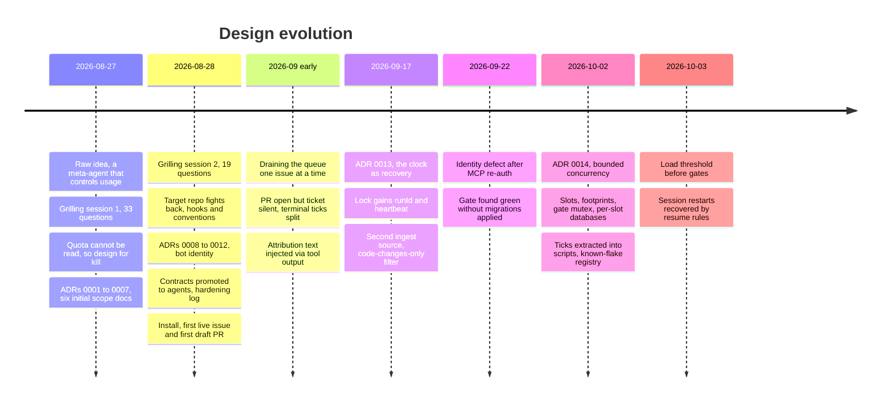

# Design history

How the Linear pipeline got from a one-paragraph idea to a bounded-concurrency system that shipped
pull requests against a production TypeScript monorepo at a startup. The decisions are recorded in the
ADRs under [`.claude/skills/linear-pipeline/adr/`](../.claude/skills/linear-pipeline/adr/); this
document tells the story that connects them and lists what was rejected along the way.

The dates are when things happened in 2026. The design was done and first installed over two days in
late August; it was then operated for about five weeks, during which two further ADRs changed it.

---

## 1. The starting point: a meta-agent that "controls usage"

The project began as a paragraph. A supervisor agent would pull Linear issues and be "solely
responsible for controlling the context usage of the other agents so that overusage of the claude
system does not cause lapses in work". It would invoke a planner when context was insufficient and a
*handoff agent* when it was sufficient, then "one or more worker agents in a worktree", an antagonistic
reviewer, a loop "until the goal is reached", a documentation agent, and finally a branch, commits and
a pull request. Seven empty design stubs existed.

Two structural problems were visible before any design work started. The handoff agent sat on only one
of the two paths into the worker. And "invoke a planner for further discovery" implied a research role
the roster did not have.

## 2. Grilling session 1: the quota cannot be seen

The first design session used an iterative design-interrogation method (the `/grill-me` skill): the
designer is asked one pointed question at a time, with a recommended answer, until the design tree is
resolved. It ran to 33 questions over nine rounds. Twenty-seven were answered with the recommendation;
six deviated.

**The most consequential finding came from inspecting the CLI, not from design.** There is no
programmatic readout of remaining team quota: `/usage` is interactive, and `--max-budget-usd` applies
only to API-key billing. And a parent agent cannot observe a subagent's token use. The idea's central
claim, a supervisor that controls usage, was not implementable as stated.

**The reframe.** Looking at the team usage meter, the author restated the real goal: minimise the
damage done to subagents when the team usage limit is reached, with no loss of data while the run waits
for the limit to reset. "Context control" had never been about context windows. It was a durability
and resumability problem, not a context-budgeting one. That became **design for kill**
([ADR-0001](../.claude/skills/linear-pipeline/adr/0001-design-for-kill-instead-of-quota-metering.md)):
any claim that the supervisor manages, monitors or throttles usage is false and was removed.

Other decisions from the session:

- **Handoff is a document, not an agent.** The plan *is* the handoff brief
  ([ADR-0002](../.claude/skills/linear-pipeline/adr/0002-the-plan-is-the-handoff-brief.md)). Discovery
  was added as the cheap, disposable reader that spends tokens so the expensive planner does not.
- **Linear is the human decision surface.** Offered "Linear is authoritative" or "local state is
  authoritative", the author chose a third option: local state is the machine's memory, and Linear
  carries decisions and outcomes. Write-back is a decision brief, complete enough that a person or a
  fresh agent can act without the work log.
- **Discovery always runs** ([ADR-0003](../.claude/skills/linear-pipeline/adr/0003-discovery-always-runs.md)).
  The "is the context sufficient?" branch was deleted.
- **The reviewer blocks only on correctness, security or an unmet requirement**, and an objective verify
  gate is the other half of "done"
  ([ADR-0004](../.claude/skills/linear-pipeline/adr/0004-reviewer-may-block-only-on-correctness-security-or-requirements.md)).
- **Paired stage states** ([ADR-0005](../.claude/skills/linear-pipeline/adr/0005-paired-stage-states.md)),
  **only the supervisor writes outward**
  ([ADR-0006](../.claude/skills/linear-pipeline/adr/0006-the-supervisor-is-the-only-outward-actor.md)),
  and **retrospectives stay local**
  ([ADR-0007](../.claude/skills/linear-pipeline/adr/0007-retrospectives-are-local-only.md)).

Three internal contradictions were resolved along the way:

- A worktree requires a branch, so branch creation had to move before the worker rather than being a
  terminal step.
- Routing the review loop (back to planning or back to discovery) was impossible without reading the
  review, which the by-reference rule forbids. The fix was the `NEEDS_DISCOVERY` flag on the reviewer's
  status line.
- Retrospectives were wanted as an audit trail but lived under the ignored `.issues/` directory. They
  became local scratch.

The output was seven documents (an overall scope plus one contract per agent, each in eight parts:
responsibility, triggers, inputs, outputs, tools, termination, context budget, anti-goals) and ADRs
0001 to 0007.

## 3. Grilling session 2: the target repository fights back

The second session started from the question "how much more input do we need before implementing?"
The premise was half right. Configuration was missing: eleven fields were referenced and none defined.
But the agent contracts already were the process flows. What was really missing was packaging, the
supervisor's loop as a procedure ("what do I do when I wake up?"), and everything about the real
target repository.

Nineteen questions over five rounds; four deviations. The session's summary: six collisions with the
real target repository were found by inspection, none of which any amount of design-document work
would have surfaced.

| Finding | Consequence |
|---|---|
| Agent definitions support `model`, `effort` and enforced `tools`; skills support `allowed-tools` but not `effort` | Hybrid packaging: leaf agents as agent definitions, supervisor as a skill ([ADR-0009](../.claude/skills/linear-pipeline/adr/0009-leaf-agents-are-agent-definitions-supervisor-is-a-skill.md)). Corrected mid-session after an initial reading of too narrow a sample |
| The Linear MCP connection authenticates per server entry | A second entry can hold a second identity, which became the bot user ([ADR-0012](../.claude/skills/linear-pipeline/adr/0012-separate-linear-identity-for-the-pipeline.md)) |
| Dozens of existing worktrees in two conventions, an established branch format, and a base branch that was not `main` | Adopt the repository's conventions ([ADR-0011](../.claude/skills/linear-pipeline/adr/0011-adopt-the-target-repo-git-conventions.md)) rather than inventing an `agent/ID` scheme |
| Lint and typecheck were separate commands | `verify` became an ordered array of named commands |
| **Pre-commit hooks reject failing commits and rewrite files mid-commit** | The first design's "a red commit is allowed because it preserves the checkpoint" was impossible. The recommendation was `--no-verify`; the author chose to honour the hooks instead ([ADR-0010](../.claude/skills/linear-pipeline/adr/0010-honour-commit-hooks.md)). Uncommittable work is stashed, and resume checks the stash first |
| The repository's agent-instructions file was about 28 KB (roughly 7,000 tokens) | A per-dispatch cost across five agents and every attempt. Accepted, with a note to measure before acting |

Other decisions:

- **Promote the design contracts into the agent files** rather than keep two copies. The agent file is
  the one that runs, so a parallel design document silently becomes a lie.
- **Config as a documented example plus a startup checklist**, not a JSON schema. A schema would be a
  document describing a document, checked by neither.
- **One shared attempt counter** for gate failures and blocking reviews.
- **Re-discovery capped at one.**
- **The loop is one transition per tick**, keyed on stage alone, with a single state file written by
  temp-file-and-rename.
- **One worker per issue** ([ADR-0008](../.claude/skills/linear-pipeline/adr/0008-one-worker-per-issue.md)),
  and one active issue at a time.
- **Setup mode lives inside the skill** and stops after writing the config.
- **A separate bot user** over an invisible comment marker, because people can then also tell who
  wrote a comment.
- **Kill testing by live interruption only.** The recorded consequence: one resume path (between push
  and PR creation, about a second wide) ships without a deliberate kill test.

## 4. Hardening the prompts

Turning eight-part contracts into running agent prompts produced its own rule set, written down in a
hardening log and applied to every agent so later ones would not regress.

- **Mechanics.** Every artifact-producing agent needs `Write` (three early drafts lacked it and could
  not work). The agent's `name` matches its filename. Bodies stay under the size limit. **No `<example>`
  blocks**, so nothing auto-dispatches.
- **Structure.** Numbered steps in execution order. Each step ends on a demanding completion criterion.
  A concept's rules live together. The return contract is its own final step.
- **Behaviour.** Prompt the positive: prohibition drags the forbidden behaviour into context and makes
  it more available. Keep prohibitions only as guardrails, each with a reason, because a rule with a
  reason survives paraphrase. Use leading words. Caps are ceilings, not targets: a "3000 words" cap was
  read as an instruction to write 3000 words. Replace a category ban with a test the output must pass
  ("a blocking finding carries a repro"). Name the reader of every artifact.
- **Skill mechanics.** User-invoked only, because a skill that pushes branches and opens pull requests
  is better off unreachable by autonomous choice. The supervisor prompt is deliberately long because it
  loads once per run; agents load per dispatch and stay tight.
- **Pruning.** One source of truth per rule (the decision-brief format moved to one reference file).
  Put behind a pointer what only some branches need. Never cache in a prompt what config answers.
- **Regressions caught.** Turning tables into steps silently dropped the unpark path from two agents. A
  retry budget was hard-coded in the worker prompt (it is now passed in the dispatch). And reframing the
  severity model around "demonstrability" made a repro *sufficient* to block, where ADR-0004 requires it
  to *also* show a correctness, security or requirement failure. The lesson: check a reframing against
  the ADR that fixed the semantics, not only against the prose it replaced.
- **Installation findings.** MCP tool names are `mcp__<server-name-verbatim>__<tool>`. The supervisor
  was told both "metadata only" and "cache the ticket", a contradiction resolved by the fetch script.
  `jq` was absent, so helpers use the Python standard library only. A secret was about to land in a
  committed file, so the API key is environment-only. Failure paths were tested live with a fake key.
  Narrow the Bash allowlist by shipping a script rather than granting a general tool.

The design documents were left as written. They record what was decided; the prompts are what runs.
The two may differ in shape as long as they do not differ in meaning.

## 5. First runs

The first live issue ran on the evening the install finished. Discovery hit a product ambiguity and
posted a decision brief; a teammate answered eight minutes later; a draft PR followed about 67 minutes
after pickup.

The first completed run also produced the system's most-cited failure. The PR opened, and the run
reported success while skipping both the Linear write and the worktree removal. The fix split
`PR_OPEN`, `LINKED` and `HANDED_OFF` into separate ticks and made the close-out verify each completed
issue against external facts.

Running one issue at a time through September surfaced most of the [lessons](lessons.md): attribution
text arriving in tool output, artifact paths resolved relative to the worktree, documentation edits
landing in the main checkout, a gate command that differed from CI's, commit-subject length rules
ignored. The operator also:

- widened intake with a second source (their own high- and medium-priority tickets) and later a
  classifier-built shortlist;
- added a **code-changes-only** filter with a strict "no comment on non-code tickets" rule, after
  noticing that many feedback tickets were not code defects at all;
- raised the attempt cap from 3 to 5. No shipped issue needed more than 4.

## 6. ADR-0013: the clock

[ADR-0013](../.claude/skills/linear-pipeline/adr/0013-the-clock-is-a-recovery-mechanism.md) was
driven by measurement. Over one long drain the supervisor ended 199 turns, and needed a human restart
six times. Every one traced to the completion-notification chain breaking at the keyboard: three
interrupts, two stopped agents, one context clear. Nothing had crashed.

Design for kill had answered *state* and was silent about *continuity*. The ADR adds a deliberately slow
fallback wake (20 to 30 minutes) that only notices a broken chain, plus the changes that made it safe:
a `runId` in the lock, staleness measured from a heartbeat, an in-flight guard before every dispatch, a
cold-start and tick split, and the removal of `maxIssuesPerRun`.

It also exposed a latent bug that predated it: lock staleness measured from `startedAt` could expire
under a single 27.6-minute worker.

## 7. ADR-0014: bounded concurrency

ADR-0008 had given two reasons for one active issue. The first, that one worker and one branch make
checkpoint and resume unambiguous, still stands within an issue. The second, keeping the supervisor's
context flat, turned out not to need one active issue at all: by-reference routing already makes each
in-flight issue cost one line per stage.

What one active issue had silently bought was exclusive use of the shared machine. What it cost was the
operator. Every operator-only step stalled the whole queue. The operator was not the bottleneck on
work; the pipeline made them the bottleneck on everything.

[ADR-0014](../.claude/skills/linear-pipeline/adr/0014-bounded-concurrency-across-issues.md) is in
effect a table of shared resources and their answers: per-slot databases, one gate at a time, per-slot
build caches, one migration in flight, footprint overlap checks, and `WAITING_OPERATOR` for the
operator. The default of one slot reproduces the earlier behaviour exactly, and an old state file
migrates its `active` issue into slot 1.

The first concurrent run, with five slots, validated and stressed it at once:

- Three session restarts killed every running agent; all slots recovered through the resume table.
- Gates flaked at a load average of about 33 on 16 cores, because the gate mutex does not cover
  worker-side builds and tests. A load threshold before taking the gate followed.
- The test harness's sibling database had never been migrated by the gate. The gate now migrates it.
- The admission script printed `WAIT` but exited 0, so a chained command created a worktree for a
  colliding slot. It was harmless that time and fixed the same night.

The ticks themselves were extracted into scripts the same day: admission, slot creation, the gate and
shipping. That is the natural direction for a system like this: a prose procedure becomes a
deterministic script once the procedure has stabilised.

---

## 8. Rejected alternatives

| Question | Chosen | Rejected, and why |
|---|---|---|
| How to survive the usage limit | Design for kill: ticks, paired states, atomic writes, commits as checkpoints | A self-estimated cost counter: no ground truth, would drift, and would give false confidence. Supervisor self-compaction: needs runtime support that does not exist |
| The agent roster | The plan is the handoff brief; discovery added as a cheap reader | A handoff agent: an extra hop of context copying, and dead weight on half the paths |
| Runtime | One Claude Code session with subagents | Headless processes, a daemon or cron (deferred) |
| Linear's role | The human decision surface; write-back is a decision brief | "Linear is authoritative" or "local state is authoritative" |
| Who resumes after a kill | Originally a human re-invokes; later the fallback clock (ADR-0013) | The supervisor sleeping through the window; scheduled auto-resume (at first) |
| Human gates | An ambiguity gate plus escalation; otherwise autonomous to a draft PR | Always gate on the plan; fully autonomous; label-driven gating |
| "Is the context sufficient?" | Delete the branch: discovery always runs | The supervisor judging the ticket: requires reading it, and fails in the expensive direction |
| When the goal is reached | A severity model (block only on correctness, security, requirements) plus an objective gate | "The reviewer must be satisfied", which never terminates |
| Parallelism within an issue | One worker, sequential steps, commits as checkpoints | Several workers in one tree (corrupt each other); fan-out with merge (real scope, deferred); file partitioning (fails silently when imperfect) |
| Where knowledge goes | Curated `docs/` notes committed with the PR; retrospectives local | Appending to the agent-instructions file (loads into every agent and attacks the token budget); committing retrospectives (git cannot re-include under an ignored directory) |
| Reviewer input | Plan, diff and free read of the whole codebase | Diff only: misses the bug of omission, which agent-written code is most prone to |
| Git ownership | Supervisor plumbs; worker commits | Worker owns everything; a separate integrator agent |
| Verification | Worker runs targeted checks; supervisor runs the authoritative gate | Reviewer runs the tests, which re-merges the objective and subjective gates |
| State model | Paired `*_STARTED` / `*_COMPLETE` | Completion-only, which cannot tell a finished stage from a killed one |
| Artifact layout | `cycle-N/` directories; nothing overwritten | Flat or latest-only files |
| Linear writes | Supervisor only | Each agent speaks for itself, which double-posts after a kill |
| Docs commits | On the feature branch, in the same PR | Direct to the base branch; a separate docs PR |
| Unparking | The newest human comment after the brief | A label change or a re-invocation ritual |
| A blocked issue | Park it and continue the queue | End the run |
| Lock | Mandatory stale timeout | No lock; an interactive takeover prompt |
| Red commits | Honour hooks; stash uncommittable work | `--no-verify` to preserve the checkpoint |
| Config format | Documented example plus startup checklist | A JSON schema |
| Two budgets or one | One shared attempt counter | Separate gate and review budgets: two ways to loop |
| Bot identity | A separate Linear user on a second MCP entry | An invisible marker in the pipeline's comments |
| Waking a stopped loop | A slow fallback clock that only notices a broken chain | A fast timer as the scheduler (would mostly fire into running work) |
| Concurrency across issues | Slots admitted by footprint, one gate, per-slot databases | Fan-out within one issue; parallel gates with a CPU budget (needs a load model and would still flake); one shared database with per-slot schemas (tools assume the default schema) |

Two choices were made against the recommendation and recorded as risks:

- **The worktree is removed once the PR is open**, rather than kept for follow-up work.
- **Generous caps** on artifact length, plan steps and review findings, to start loose and tighten
  later. In practice a cap was read as a target, which led to the "ceilings, not targets" rule.
