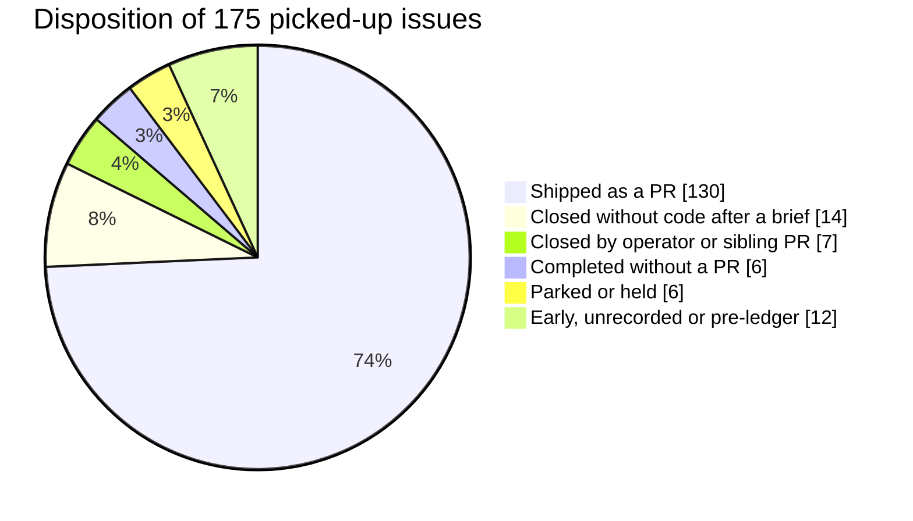
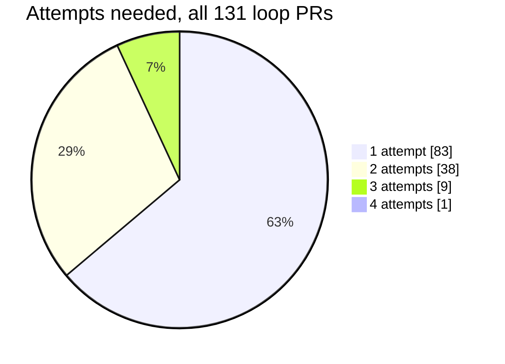
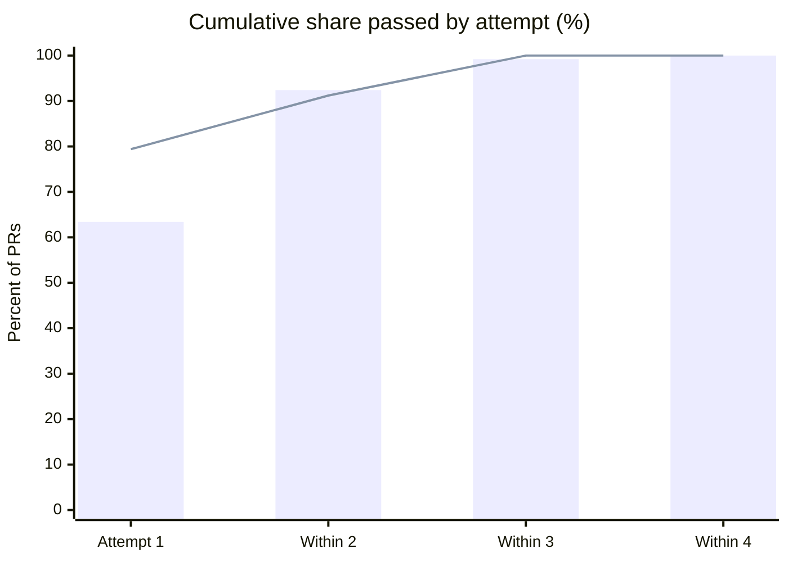
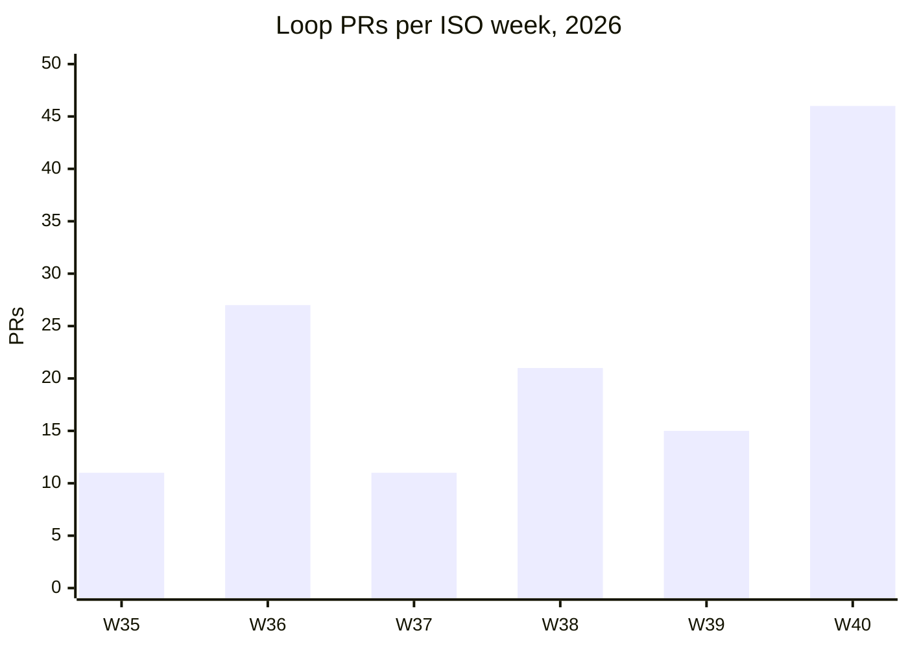
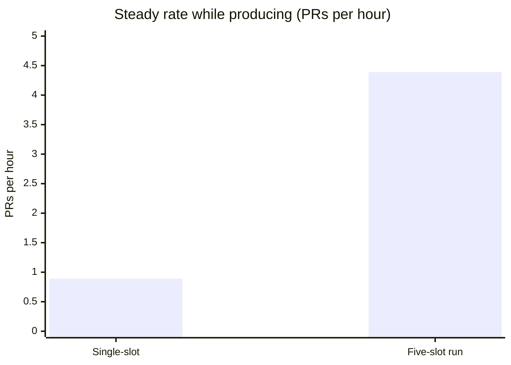

# Run statistics

Measured results from operating the pipeline for about five weeks, from 28 August to 3 October 2026.

- **Target:** a production Next.js/TypeScript monorepo, with its own CI, pre-commit hooks and human
  code review.
- **Source of the numbers:** the pipeline's own run records (the supervisor's state file and its
  archive of completed issues, and the per-issue workspaces), joined with the code host's PR list and
  an export of the Linear issues. All figures are aggregates. No ticket, PR or person is identified.
- **Labels:** every figure is marked **measured** (counted directly from a record) or **inferred**
  (derived with a stated assumption).

These are one team's numbers on one codebase, during a period when the pipeline itself was still
changing. They show what the design did in practice; they are not a benchmark.

## Contents

1. [Scopes used in this document](#1-scopes-used-in-this-document)
2. [Headline results](#2-headline-results)
3. [Totals and dispositions](#3-totals-and-dispositions)
4. [Attempts](#4-attempts)
5. [Throughput](#5-throughput)
6. [The five-slot run](#6-the-five-slot-run)
7. [Latency](#7-latency)
8. [PR size](#8-pr-size)
9. [Review findings](#9-review-findings)
10. [Plans and footprints](#10-plans-and-footprints)
11. [Triage](#11-triage)
12. [Operational incidents](#12-operational-incidents)
13. [Method notes and caveats](#13-method-notes-and-caveats)

---

## 1. Scopes used in this document

Numbers below are always labelled with one of these scopes. They overlap, and figures from different
scopes should not be compared without reading the caveats.

| Scope | Window | PRs | What it covers |
|---|---|---:|---|
| **All-time** | 2026-08-28 to 2026-10-03 (35.4 days) | 131 | Every PR the pipeline loop produced |
| **First 30 days** | 2026-08-28 18:54Z to 2026-09-27 18:54Z | 85 | The first 30 days from the first PR |
| **Ledger** | 2026-09-02 to 2026-10-03 (30.5 days) | 105 | PRs recorded in the supervisor's completed-issue archive, which began on 2 September |
| **Pre-ledger** | 2026-08-28 to 2026-09-02 | 26 | PRs from before the archive existed; attempt counts inferred |
| **Single-slot** | 2026-08-28 to 2026-09-30 | 97 | One issue in flight at a time |
| **Five-slot run** | 2026-10-02 17:03Z to 2026-10-03 05:06Z | 34 | One run with `limits.maxConcurrent: 5` |

**Which PRs count.** A PR counts if its URL is recorded in the ledger, or if it predates the ledger and
its branch names an issue that has a pipeline workspace whose recorded PR title matches. Excluded: one
ledger PR that was an operator-requested fix done outside the loop, and four later PRs the operator
opened by hand to re-carry or split pipeline work.

---

## 2. Headline results

| Result | Value | Scope | Kind |
|---|---|---|---|
| Pipeline PRs | **131** | All-time (~35 days) | measured |
| PRs in the first 30 days | **85** | First 30 days | measured |
| Passed review within 1 / 2 / 3 attempts | **63% / 92% / 99%** | All-time | measured (pre-ledger attempts inferred) |
| Merged | **128 of 131 (97.7%)**; 0 closed unmerged; 3 still open | All-time | measured |
| Escalations at the attempt cap | **0** | All-time | measured |
| Five-slot run: PRs shipped | **34** | Five-slot run | measured |
| Five-slot run: first-attempt pass | **79%** (27 of 34) | Five-slot run | measured |
| Five-slot run: weighted mean attempts | **1.3** (1.29) | Five-slot run | measured |
| Five-slot run: sustained pace | **4.39 PRs/hour** | Five-slot run, while producing | measured |
| Five-slot run: ~100 PRs per 24 hours | **extrapolation**, not a measured day | Five-slot run | inferred |
| Five-slot run: actual start-to-finish rate | **2.82 PRs/hour, about 68 per 24 hours** | Five-slot run, stall included | measured rate, inferred projection |
| Single-slot sustained pace | **0.89 PRs/hour** | Single-slot | measured |

**On the "about 100 per day" figure.** No 24-hour five-slot run exists. The run lasted 12 hours from
start to last ship. While it was producing, it shipped at 4.39 PRs per hour, which projects to about
105 in 24 hours. The same run, measured from its start to its last ship and including a 4.1-hour stall,
shipped at 2.82 PRs per hour, which projects to about 68. Treat "about 100 per 24 hours" as a statement
about sustained pace, not as an observed day.

---

## 3. Totals and dispositions

| Measure | Value | Kind |
|---|---:|---|
| Issues the pipeline picked up | 175 | measured: distinct issue workspaces |
| PRs produced by the loop | 131 | measured |
| ...recorded in the ledger | 105 | measured |
| ...before the ledger existed | 26 | measured (their attempt counts are inferred) |
| Distinct issues shipped as a PR | 129 | measured; two issues shipped twice after a QA rejection sent each back through the loop |
| Merged | 128 of 131 (97.7%) | measured, code host state at time of fetch |
| Closed unmerged | 0 | measured |
| Still open (draft) | 3 | measured, all from the most recent run |
| Landed on the base branch | 128 of 131 (97.7%) | measured, directly or through a batched integration branch that then merged |

Final disposition of every picked-up issue, each counted once:

| Disposition | Issues |
|---|---:|
| Shipped as a pipeline PR | 129 |
| Shipped outside the loop (operator-requested fix) | 1 |
| Parked as blocked, awaiting a decision | 5 |
| Held, waiting on an operator-only step | 1 |
| Completed without a PR (verification, investigation, tracker-only, or split) | 6 |
| Closed without code after a decision brief | 14 |
| Closed by the operator (already done, or chosen to close) | 6 |
| Closed by a sibling PR | 1 |
| Dispositioned before the ledger (closed, deferred or reassigned) | 4 |
| No recorded disposition (early workspace, folder only) | 8 |
| **Total** | **175** |

(The pie merges rows: "Shipped as a PR" includes the out-of-loop fix.)

**Decision briefs.** 80 issues have a written decision brief, meaning the pipeline stopped and asked a
human. 39 of those later shipped after an answer; 41 did not. 12 human answers were recorded as
files. All 5 issues still parked are parked as blocked. No issue was ever parked by escalation.

---

## 4. Attempts

An **attempt** is one pass of plan, implement, verify and review. A failed verify gate and a blocking
review both start a new attempt, on one shared counter. The configured cap during operation was 5. The
most any shipped PR needed was 4, so no issue hit the cap.

| Population | n | 1st attempt | Within 2 | Within 3 | Within 4 | Mean attempts |
|---|---:|---:|---:|---:|---:|---:|
| **All loop PRs (all-time)** | 131 | 63.4% | 92.4% | 99.2% | 100% | 1.45 |
| Ledger, loop only | 105 | 66.7% | 91.4% | 99.0% | 100% | 1.43 |
| Pre-ledger (attempts **inferred**) | 26 | 50.0% | 96.2% | 100% | 100% | 1.54 |
| First 30 days | 85 | 55.3% | 92.9% | 98.8% | 100% | 1.53 |
| Single-slot, ledger only | 71 | 60.6% | 91.5% | 98.6% | 100% | 1.49 |
| Single-slot, including pre-ledger | 97 | 57.7% | 92.8% | 99.0% | 100% | 1.50 |
| **Five-slot run** | 34 | 79.4% | 91.2% | 100% | 100% | 1.29 |

Attempt distribution over all 131 loop PRs:

Cumulative pass rate by attempt, all-time versus the five-slot run:

Bars: all 131 loop PRs. Line: the 34 PRs of the five-slot run.

**Method.** Ledger attempt counts are **measured**: they are the supervisor's own counter. For the 26
pre-ledger PRs the count is **inferred** as the highest attempt number found in that issue's plan and
review headers or `cycle-N` directories. Mean attempts is total attempts divided by PRs.

**Caveat: the five-slot run's higher first-attempt rate is confounded.** All but one of its tickets
came from a classifier shortlist of tickets judged doable with a PR alone (section 11). The difference
cannot be attributed to concurrency.

---

## 5. Throughput

A PR's creation time is used as its ship time. Where the ledger also records a finish time, the two
agree within 0.5 minutes at the median (maximum 14.1 minutes, n=67).

| Measure | Value | Kind |
|---|---|---|
| First and last pipeline PR | 2026-08-28 18:54Z, 2026-10-03 05:06Z | measured |
| Span | 35.4 days, with ships on 22 of them | measured |
| Busiest day | 19 PRs | measured |
| First 30 days | 85 loop PRs (86 including the out-of-loop fix) | measured |
| Average over the span | 3.7 PRs per calendar day; 6.0 per day on which anything shipped | measured |

Week 40 contains the five-slot run (34 of its 46 PRs).

### 5.1 Single-slot versus five-slot pace

**Method.** The **steady rate** is the number of gaps between consecutive ships that are 3 hours or
shorter, divided by the total length of those gaps. It measures pace while the pipeline was producing,
and excludes idle time between sessions, stalls and nights. It is not a 24-hour average.

| Period | Ships | Gaps kept / excluded | Steady rate (PRs/hour) | Median gap, gaps of 3 h or less |
|---|---:|---:|---:|---:|
| Single-slot, all loop PRs (PR creation times) | 97 | 74 / 22 | **0.89** | 58.5 min |
| Single-slot, ledger finish times only | 33 | 21 / 11 | 0.80 | 69.5 min |
| Five-slot run | 34 | 32 / 1 | **4.39** | 7.0 min |

Five slots shipped about **4.9 times** the single-slot steady rate, close to the ceiling of 5, even
though only one verify gate runs at a time and concurrent builds slowed one another. The two periods
also drew from different queues (section 4), so this is a throughput comparison, not a controlled
experiment.

### 5.2 Sessions

Session boundaries are **inferred**: consecutive ships more than 6 hours apart start a new session. The
ledger names a run only for the last four runs.

| # | Start (UTC) | PRs | First-to-last span (h) | Steady rate (PRs/h) | Median gap (min) |
|---:|---|---:|---:|---:|---:|
| 1 | 08-28 18:54 | 11 | 11.5 | 0.87 | 59.8 |
| 2 | 08-31 23:04 | 2 | 1.1 | 0.94 | 63.9 |
| 3 | 09-01 15:53 | 11 | 10.3 | 1.25 | 46.2 |
| 4 | 09-02 14:47 | 14 | 13.6 | 0.95 | 37.1 |
| 5 | 09-08 22:13 | 3 | 2.3 | 0.87 | 69.3 |
| 6 | 09-10 17:45 | 2 | 3.1 | n/a | 183.9 |
| 7 | 09-11 16:52 | 6 | 5.1 | 0.98 | 42.6 |
| 8 | 09-15 20:56 | 4 | 2.7 | 1.12 | 55.4 |
| 9 | 09-16 20:03 | 9 | 10.9 | 0.73 | 72.2 |
| 10 | 09-17 17:15 | 4 | 5.7 | 0.75 | 92.3 |
| 11 | 09-18 17:38 | 4 | 3.5 | 0.86 | 60.2 |
| 12 | 09-21 16:45 | 6 | 7.2 | 0.69 | 90.9 |
| 13 | 09-22 18:19 | 2 | 2.5 | 0.40 | 150.6 |
| 14 | 09-23 15:54 | 3 | 5.8 | 0.67 | 173.4 |
| 15 | 09-24 16:57 | 4 | 5.8 | 0.89 | 85.7 |
| 16 | 09-29 16:53 | 7 | 8.3 | 1.22 | 46.8 |
| 17 | 09-30 17:19 | 5 | 5.3 | 0.75 | 74.9 |
| 18 | 10-02 17:41 | 34 | 11.4 | 4.39 | 7.3 |

Sessions 1 to 17 ran one issue at a time. Session 18 is the five-slot run.

---

## 6. The five-slot run

Measured from the ledger's finish times.

| Measure | Value |
|---|---|
| Run start | 2026-10-02 17:03Z |
| Queue | 43 tickets (the classifier shortlist, section 11) |
| Shipped / parked / not reached | 34 / 4 / 5 |
| Attempts needed (1 / 2 / 3) | 27 / 4 / 3 |
| First-attempt pass | 79.4% |
| Weighted mean attempts | 1.29 |
| Time to first ship | 38 min |
| Start to last ship | 12.05 h |
| Window 1 | 17:41 to 21:33, 19 ships, 4.65 PRs/h |
| Longest gap (a stall) | 4.12 h, 21:33 to 01:41 |
| Window 2 | 01:41 to 05:06, 15 ships, 4.09 PRs/h |
| **Steady rate, both windows** | **4.39 PRs/h** |
| Realised rate, start to last ship (stall included) | 2.82 PRs/h |
| Realised rate, excluding the stall | 4.29 PRs/h |
| Gap between consecutive ships | median 7.0 min, p75 13.7, p90 45.2, max 247.3 (n=33) |
| Ships per slot (slots 1 to 5) | 11, 7, 4, 6, 6 |

**24-hour projections (inferred; these are extrapolations, not measurements):**

| Basis | Projection |
|---|---:|
| Steady rate (4.39/h) | 105 |
| Run's own rate excluding the stall, startup included (4.29/h) | 103 |
| **Actual start-to-last-ship rate, stall included (2.82/h)** | **68** |

**Interruptions during the run** (measured from the run's own notes): three session restarts that
killed every running agent, the first caused by a machine reboot; and one 4.1-hour stall, during which
the operator approved releasing slots that were waiting on a stalled slot. Every slot interrupted by a
restart was recovered through the resume rules. A later gate note also mentions a reboot in the small
hours; the record does not say whether this was a second reboot.

---

## 7. Latency

| Interval | Median | p75 | p90 | Max | n | Kind |
|---|---:|---:|---:|---:|---:|---|
| Pickup to PR opened, all loop PRs | 0.88 h | 1.65 h | 10.5 h | 250 h | 128 | **inferred** |
| Pickup to PR opened, five-slot run | 0.89 h | 1.57 h | 7.6 h | 250 h | 34 | **inferred** |
| PR opened to merged | 49.8 h | 71.8 h | 101.6 h | 290.6 h | 128 | measured |
| PR opened to landed on the base branch | 51.7 h | 72.1 h | 102.3 h | 291.0 h | 128 | measured |
| Ticket created to PR opened | 51.2 days | 64.8 days | 94.1 days | 127.6 days | 131 | measured |

Notes:

- **Pickup time is not logged.** The pickup-to-PR figures use the modification time of the issue's
  cached ticket file, which is written at pickup but can be rewritten when an issue is picked up again
  (for example after an unpark). Three PRs where the file is newer than the PR were excluded. The long
  tail most likely reflects issues that parked and waited for a human answer, or were re-picked.
- **PR opened to merged** is human time: merges were done by people, in batches.
- **Ticket created to PR opened** is the age of the backlog the pipeline drained, not pipeline latency.

---

## 8. PR size

Loop PRs, all-time (n=131). "Code" columns exclude generated files: migration snapshots, pipeline
artifacts, data backups and lockfiles.

| Measure | Median | p75 | p90 | Max | Total |
|---|---:|---:|---:|---:|---:|
| Lines added, code | 295 | 578 | 917 | 3,311 | 58,212 |
| Lines deleted, code | 15 | 51 | 119 | 411 | 5,919 |
| Lines added, raw | 300 | 596 | 1,223 | 40,104 | 242,700 |
| Lines deleted, raw | 16 | 52 | 119 | 411 | 6,018 |
| Changed files | 6 | 11 | 19 | 80 | 1,200 |
| Commits per PR | 6 | 10 | 14 | 29 | 938 |

Raw counts include generated migration snapshot files (one PR adds over 40,000 raw lines, almost all
snapshot), which is why the code columns are preferred. Net code lines across all loop PRs: +52,293.

By period, the median code lines added were 292 (single-slot) and 300 (five-slot); the median changed
files were 6 in both. The five-slot run had fewer commits per PR (median 4 versus 7).

The commit count reflects the worker's design: one commit per plan step, each passing the repository's
pre-commit hooks.

---

## 9. Review findings

The reviewer is adversarial but may block only on correctness, security or an unmet requirement, and a
blocking finding must carry a repro. Every review file opens with a verdict line
(`BLOCKING: n ADVISORY: m NEEDS_DISCOVERY: 0|1`), which was parsed from every review file in every
shipped issue's workspace, with identical copies removed.

| Measure | Value | Kind |
|---|---:|---|
| Review files parsed | 163 (attempt 1: 109, 2: 44, 3: 9, 4: 1) | measured |
| Blocking findings in preserved review files | 39 | measured; a **lower bound** |
| Advisory findings in preserved review files | 992 | measured; counted as reported, so a repeated advisory is counted again |
| Advisory findings per first review | median 6, p75 7, p90 9, max 12 (n=106) | measured |
| Blocking findings per first review | mean 0.26, max 3 | measured |
| First reviews with zero blocking findings | 84 of 106 (79.2%) | measured, but **biased upward** |
| Reviews that asked for re-discovery | 5 | measured |
| Issues where re-discovery ran | 4 | measured |
| Escalations at the attempt cap | 0 | measured |

**Coverage caveat.** Early workspaces overwrote the review file on each attempt (the `cycle-N/` layout
came later). A first-attempt review survives for 83 of 84 one-attempt PRs, but only 16 of 34
two-attempt, 7 of 9 three-attempt and 0 of 1 four-attempt PRs. PRs that needed rework are therefore
under-represented, and the 79% zero-blocking share overstates the first-review pass rate. The ledger's
attempt counts (section 4) are the authoritative figure. Where both records exist they agree: every
one-attempt ledger PR with a preserved first review shows zero blocking findings (70 of 70).

Advisory findings are not lost: they go into the PR body for the human reviewer. A median of six per
first review is consistent with the reviewer's contract, which treats a review of only advisory
findings as a review that did its job.

---

## 10. Plans and footprints

| Measure | Value | Kind |
|---|---|---|
| Steps per first plan (shipped PRs) | median 5, p75 7, p90 10, max 20 (n=120) | measured: numbered step headings |
| Steps per plan, all distinct plans | median 5, p75 7, p90 9, max 20 (n=172) | measured |
| Steps per rework plan (attempt 2 or later) | median 5, p75 6, p90 8, max 11 (n=50) | measured |
| Footprint files | 38; declared paths per footprint median 5.5, p75 9.5, p90 12.3, max 19 | measured; footprints exist only from the concurrency era |
| Issues whose artifacts mention widening or leaving the footprint | 6 | **inferred** by keyword search |
| PRs adding a database migration | 8 PRs, 11 migration files | measured |

---

## 11. Triage

Two triage mechanisms fed the queue in the later weeks. Both are optional.

**Code / not-code triage** (the `linear.codeChangesOnly` rule: queue only tickets whose resolution is a
commit in this repository). 101 tickets classified: 91 code, 6 not code, 4 ambiguous. In the latest
pass, the 6 not-code and 4 ambiguous tickets were left untouched, with no comment.

**Classifier triage.** An external classifier (typed judgments combined with code-derived evidence, such
as whether a PR already names the issue and whether the referenced files exist) sorted 104 backlog
tickets into buckets:

| Bucket | Tickets |
|---|---:|
| Needs a decision | 30 |
| Pure PR | 24 |
| Likely PR, needs review | 19 |
| Not a PR | 16 |
| PR plus an operational step | 10 |
| Already resolved | 5 |

**Evaluation against hand labels** (54 tickets: 28 labelled PR-able, 26 not):

| Positive prediction | Precision | Recall | TP / FP / FN / TN |
|---|---:|---:|---|
| "Pure PR" or "likely PR" | **63.6%** (14/22) | **50.0%** (14/28) | 14 / 8 / 14 / 18 |
| "Pure PR" only | 66.7% (10/15) | 35.7% (10/28) | 10 / 5 / 18 / 21 |

**Shortlist outcome.** The 43 "pure PR" and "likely PR" tickets became the five-slot run's queue:

| Outcome | Tickets |
|---|---:|
| Shipped | 33 |
| Parked with a decision brief | 4 |
| Closed by the operator without a PR (several already done on the base branch) | 6 |

Shipped shortlist PRs passed on the first attempt 27 of 33 times (**81.8%**), mean 1.24 attempts, against
63% first-attempt across all loop PRs. By bucket, "likely PR" shipped 14 of 19 and "pure PR" 19 of 24.

**Caveats.**

- The shortlist comparison is **confounded**: every shipped shortlist ticket ran in the five-slot run,
  so the effects of the shortlist and of concurrency cannot be separated.
- The hand-labelled set is small (54 tickets).
- Recall of 50% means the classifier missed half the PR-able tickets. It was useful for building a
  high-yield queue, not for deciding what to ignore.

**Label backtest.** The classifier re-derived the issue *type* of the 130 shipped issues from their
merged PR bodies. It disagreed with the existing label on 32 (24.6% of all 130; 35.2% of the 91 that had
a type label; 39 had none). "Disagreed" means the model's judgment differs from the label, not a human
ruling that the label was wrong. Agreement with existing human labels over 175 issues: type 61.3%,
function 65.6%, effort 50.5%.

---

## 12. Operational incidents

Each record in the run notes, run findings and incident fields of the state file was read and
categorised by hand. Counts are of **records**, not of distinct root causes.

| Category | Records | See |
|---|---:|---|
| Signing-key cache expired mid-worker; operator unlocked it | 8 | [L22](lessons.md#l22-the-operator-was-the-bottleneck-on-everything) |
| Gate flake: test timeout under concurrent load | 5 | [L9](lessons.md#l9-cpu-load-flakes-under-concurrency) |
| Session restart (all agents killed, resumed) | 4 | [L20](lessons.md#l20-session-restarts-kill-local-services-not-just-agents) |
| Agent instruction-following defect | 4 | [L11](lessons.md#l11-agents-dumping-findings-into-the-supervisors-context), [L13](lessons.md#l13-a-plan-that-told-the-worker-to-push) |
| Commit-subject length rule broken by agents | 3 | [L10](lessons.md#l10-a-commit-rule-did-not-hold-under-instruction-alone) |
| Gate flake: unhandled error after test teardown | 2 | [L9](lessons.md#l9-cpu-load-flakes-under-concurrency) |
| Agents read a stale checkout | 2 | [L15](lessons.md#l15-agents-read-stale-policy-from-the-operators-checkout) |
| Pipeline tooling defect | 2 | [L26](lessons.md#l26-helper-scripts-need-exit-codes-that-mean-what-they-say) |
| Attribution instruction in tool output (disregarded) | 2 | [L5](lessons.md#l5-instructions-arrived-through-tool-output) |
| Quota kill, recovered by resume | 2 | [L2](lessons.md#l2-quota-kills) |
| Attribution trailer added by a worker (caught before push / removed by the operator) | 1 / 1 | [L5](lessons.md#l5-instructions-arrived-through-tool-output) |
| Machine reboot (local database down, resumed) | 1 | [L20](lessons.md#l20-session-restarts-kill-local-services-not-just-agents) |
| Stall handling (operator chose to defer blocked slots) | 1 | |
| Gate flake: probabilistic assertion | 1 | |
| Bot comments posted under the operator's identity | 1 | [L6](lessons.md#l6-the-bot-identity-drifted-after-re-authentication) |
| Gate did not migrate the test database | 1 | [L8](lessons.md#l8-the-gate-passed-without-the-migrations-applied) |
| Base-branch defect blocked migration-bearing tickets (fixed outside the loop) | 1 | |
| An agent's claim disproved by a later agent | 1 | [L19](lessons.md#l19-wrong-facts-propagate-across-issues) |
| Agent stall, recovered | 1 | |

- Three of the four session-restart records are from the five-slot run.
- The identity defect lasted a week. Twelve completion comments in that window carry the operator's
  name instead of the bot's. No decision brief was posted under the wrong identity.
- Four distinct test files were named as flaky. The operator approved two known-flake exceptions, and
  nine gate runs passed only after an isolated re-run of a known flake. Gate logs were preserved only
  from 29 September on (43 issues, 69 log files, 12 of them failed runs).
- Commit-subject violations were frequent but recorded only as narrative (for example "roughly half of
  all commits" in one run). They cannot be counted from the record.
- Quota kills are counted only where a note mentions one. A kill that left no note is invisible here,
  which is, in a sense, the design working.

---

## 13. Method notes and caveats

**Sources.**

- *Pipeline ledger:* the supervisor's state file and its archive of completed issues (issue, PR link,
  attempt count, finish time, run, slot). It covers PRs from 2 September onward. Two independent
  flattenings of it agree row for row (112 rows, 0 differences).
- *Per-issue workspaces:* 175 folders with findings, plans, worklogs, review files, decision briefs, PR
  bodies and gate logs.
- *Code host:* the PR list, per-PR commit counts, and per-file changes used to exclude generated files.
- *Linear:* an export of issues with status and created and completed dates. There is no status
  history, so time spent in each Linear status cannot be derived.
- *Triage artifacts:* classifier results, hand labels, evaluation and backtests.

**Not computable from the record.**

- Pickup time per issue is not logged (pickup-to-PR is inferred from file times).
- Active agent time per run: no per-stage timestamps survive outside the five-slot run's finish times.
- Attempt counts for the 26 pre-ledger PRs (inferred from artifacts).
- A complete per-attempt review history (early workspaces overwrote review files).
- Token usage and cost: not recorded. The design deliberately does not meter usage
  ([ADR-0001](../.claude/skills/linear-pipeline/adr/0001-design-for-kill-instead-of-quota-metering.md)).
- Quota kills that left no note.

**Things to keep in mind when reading these numbers.**

- **The system changed during the measurement.** The clock arrived on 17 September and concurrency on
  2 October. Single-slot figures mix several versions of the prompts.
- **Queues differed.** Early runs drained a general backlog; the five-slot run drained a
  classifier-built shortlist. Comparisons across those periods are descriptive, not causal.
- **"Merged" means a human accepted the PR,** usually after further review and QA outside the pipeline.
  It does not mean the PR needed no human changes; that is not measured here.
- **One codebase, one operator.** Results on a different repository, test suite or team will differ.
- **Earlier published figures.** A figure of "106 PRs in the first month" circulated earlier. The count
  is right for the ledger window (2 September to 3 October, including the out-of-loop fix), but that is
  not the first month: the first 30 days from the first PR produced 85 loop PRs, and the full 35 days
  produced 131. The "67% / 92% / 99%" pass rates quoted with it are correct for that 106-PR ledger set;
  over all 131 loop PRs they are 63% / 92% / 99%.
